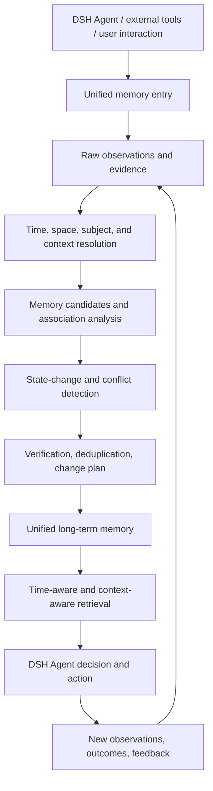

# Mnemosyne (Legacy · DSH plugin distribution shell)

**English** | [简体中文](README.md)

> **⚠️ Legacy / not the Mnemosyne 2.0 authority**  
> - **Authoritative 2.0 Node:** [`canyueY/mnemosyne`](https://github.com/canyueY/mnemosyne)  
> - **This repo (npm `dsh-mnemosyne`)** is a **DSH host plugin distribution channel / historical public package**. Do **not** use it as the measuring stick for 2.0 GA, Capability Matrix, or claims like “Identity/Bank/CLI missing.”  
> - Sync policy: do **not** silently overwrite this repo’s `service/` with the full Node; new work lands in `canyueY/mnemosyne`. See that repo’s `docs/REPO_BASELINE.md`.  
> - We are **not** GitHub-archiving this repo yet (npm installs); status = **Legacy + redirect**.

### DSH Evolving Memory System

> From remembering facts to understanding change; from retrieving the past to continuing a relationship.

Mnemosyne (`dsh-mnemosyne`) is the DSH-oriented **plugin packaging** of the evolving memory idea. For the standalone Node, use [`canyueY/mnemosyne`](https://github.com/canyueY/mnemosyne).

> **Rename note:** this project was formerly `dsh-cognitive-memory`. Legacy config keys, environment variables, and data directories remain supported for migration; install as `dsh-mnemosyne`.

Traditional memory systems mostly ask: **what was stored, and can it be retrieved when needed?**

Mnemosyne also asks:

- When was this true? Is it still true?
- Did it come from direct observation, an explicit statement, or model inference?
- What does the same event mean across different times, places, and relationships?
- When new evidence conflicts with an old memory, how should the memory change instead of simply accumulating?
- Is an emotional event a short-lived state, or an experience that may affect a long-term relationship?
- How can shared history help DSH understand the present without over-applying the past?

The goal is not merely a larger memory store. It is memory that is **temporal, contextual, traceable, evolving, and correctable**.

## At a Glance: From Storage to Evolution

*Left: traditional memory stores conclusions. Right: Mnemosyne keeps evidence, time, and change.*

---

---

## Contents

1. Why DSH Needs Mnemosyne
2. Positioning and Design Principles
3. Technical Direction
4. Core Capabilities
5. Time, Space, and Emotion
6. How Memory Works
7. Implementation Approach
8. Relationship to Other Memory Projects
9. What Changed from Earlier Versions
10. Role in DSH
11. Roadmap
12. Evaluation Criteria
13. Boundaries and Privacy
14. Project Information

---

## 1. Why DSH Needs Mnemosyne

DSH is more than a question-answering system. It aims to be an agent ecosystem that participates in a digital society, accumulates experience, develops interests, maintains relationships, and adjusts behavior from feedback.

In such a system, memory cannot be just a set of facts left after a conversation.

If an agent remembers that someone likes a certain kind of work but does not know when that preference formed, whether it has changed, or who expressed it, it may rely on stale information indefinitely.

If an agent remembers an argument but not its context, what each side said, what happened afterward, or what remained uncertain, a single event can harden into a long-term judgment about a person.

If an agent keeps only conclusions while discarding sources, process, and counter-evidence, later learning and reflection rest on weak ground.

Mnemosyne therefore treats memory as a continuing process:

**observation → evidence → association → candidate memory → verification and integration → retrieval and use → new evidence → re-evaluation**

It provides infrastructure for understanding the world and relationships; it does not make every decision for the agent.

## 2. Positioning and Design Principles

### Positioning

| Attribute | Definition |
| --- | --- |
| Name | Mnemosyne |
| English positioning | DSH Evolving Memory System |
| Chinese positioning | DSH 演化记忆系统 |
| Repository / plugin ID | `dsh-mnemosyne` |
| Ecosystem | DSH (DeepSeek Harness) |
| Core responsibility | Manage memory evidence, temporal state, contextual association, evolution, and correction |
| Long-term goal | Provide a reliable memory foundation for companionship, individualized understanding, and continuous learning |

### Design Principles

**1. One unified long-term memory system**

Mnemosyne is the evolution of the existing DSH Memory plugin, not another personal-memory system running beside it.

Emotion, time, space, behavior, and relationships must live in one memory lifecycle, so the agent does not end up with several contradictory personal profiles and sources of truth.

**2. Separate facts from interpretation**

"What was observed" and "what it is believed to mean" must remain distinct.

Direct observation, first-person statements, external sources, and model inference need different provenance labels. Inferences may be revised; they must not silently become facts.

**3. Memory has a time range**

A memory is not just a value. It should describe when the event happened, when it was recorded, when it was valid, and when it was last confirmed.

**4. Allow change, conflict, and uncertainty**

New information must not overwrite old information unconditionally. The system needs to recognize state changes, retain necessary historical relationships, and allow "unknown" as a valid answer.

**5. Memory serves the agent; it does not replace the agent**

Mnemosyne organizes evidence, maintains memory state, provides relevant history, and points out uncertainty. The DSH agent decides how to use it, whether to explore further, and what action to take.

**6. Verifiability over superficial intelligence**

Whether memory is correct, correctable, and reduces misjudgment matters more than how many plausible personal descriptions the system can generate.

---

## 3. Technical Direction

Mnemosyne moves from a memory system centered on storage and retrieval toward infrastructure centered on evidence, state evolution, and long-term continuity.

*DSH Host, Memory Service, SQLite, Worker, and Agent share one lifecycle.*

### Three Layers

#### Layer 1: Facts and Evidence

Record what happened, who said what, where the information came from, and what the system actually observed.

#### Layer 2: State and Relationships

Describe validity over time, how states changed, related entities, contextual conditions, supporting evidence, and conflicts.

#### Layer 3: Evolution and Application

Revise old judgments in light of new evidence, provide applicable history to the agent, and improve memory quality through later outcomes.

Together these layers form a feedback loop.

Adding more dimensions does not justify turning every observation into a psychological or causal explanation. Deeper inference should happen only when evidence is sufficient; otherwise, preserving facts and uncertainty is the correct result.

---

## 4. Core Capabilities

### 4.1 Temporal Memory

Ordinary memory often records information and its write time. Mnemosyne aims to distinguish:

- **Event time**: when the event actually happened.
- **Record time**: when the system learned or wrote the information.
- **Valid time**: the interval in which the information is considered true.
- **Confirmation time**: when the information was last supported.
- **Temporal precision**: exact time, estimated interval, or unknown.

This lets the system separate historical facts, current states, plans, and expired information.

*Event time, record time, valid time, and confirmation time keep "was true" and "is valid now" separate.*

Example:

> Someone used to like a certain kind of work, but recently said their interest has changed.

The system should preserve the timeline of preference change where possible, and prefer the newest applicable evidence when answering about current preferences, rather than merging the two statements into a contradictory label.

### 4.2 Evidence Provenance

Every important memory should retain sources and evidence references where possible.

Suggested categories:

- `explicit_statement`: the person explicitly said it.
- `direct_observation`: directly observed fact.
- `external_source`: information from an external source.
- `model_inference`: an inference from available evidence.
- `later_confirmation`: later confirmed information.
- `counter_evidence`: evidence conflicting with the current judgment.

These are logical categories, not a claim about the exact enum values in the repository; the implementation must stay consistent with its own data model.

*From observation, evidence, and candidate to long-term memory and recall; inference never silently becomes fact.*

Evidence provenance lets DSH answer not only what it knows, but why the memory exists, how reliable it is, and what new evidence could change it.

### 4.3 State Evolution and Conflict Handling

Facts, preferences, plans, relationships, and behavior patterns can all change.

Goals include:

- Detect whether new and old information refer to the same entity and claim.
- Distinguish supplementary information, state change, real conflict, and unrelated information.
- Retain necessary historical versions and revision relationships.
- Avoid unbounded duplication.
- Allow explicit correction to override an incorrect inference.
- Preserve conflict when evidence is insufficient instead of forcing a single answer.

A state change does not invalidate history. A current state changing does not mean the past state never existed.

*New evidence never overwrites a value directly: conflict check → change plan → write verification → state evolution.*

### 4.4 Context and Relationship Association

The same information can mean different things in different contexts.

Building on existing entity and memory-association mechanisms, Mnemosyne aims to support:

- Associations among people, events, projects, and relationships.
- The task, environment, and relational background of an action.
- Behavior changes across time periods.
- Historical retrieval of related events.
- Similarity and difference between contexts.

Association only means that pieces of information are connected. Co-occurrence or temporal proximity alone does not establish causation.

### 4.5 Emotional States and Emotional Events

Emotion is a dimension of memory, not a fixed label for a person.

Design goals:

- Allow multiple emotions to coexist.
- Record intensity, confidence, and uncertainty separately.
- Describe emotional state changes over time.
- Record emotionally significant events with long-term value.
- Build individualized emotion–behavior patterns with evidence, counter-examples, and applicability conditions.
- Re-evaluate past judgments when new evidence appears.

If someone shows strong dissatisfaction during an argument and later explains and repairs the relationship, the system should preserve the event context, what was actually expressed, possible emotional states, and the later outcome — not reduce the event to "this person is quick to anger."

*Compound emotions, intensity, confidence, counter-evidence, and later outcomes live in the same memory.*

### 4.6 Time-Aware Retrieval

Retrieval should consider more than "which memory is most similar to the query":

- Whether the query is about the past or the present.
- Whether the memory was valid at the target time.
- Whether the source is reliable.
- Whether newer evidence updates or supersedes it.
- Whether the current context resembles the historical context.
- Whether unresolved conflicts remain.

This reduces misuse of expired information and helps DSH recall shared experiences and relationship changes accurately.

### 4.7 Explainable Memory Updates

For important memory changes, generate a reviewable change plan before writing.

The plan should explain:

- What is added, updated, merged, or superseded.
- What evidence supports the change.
- Which existing memories are affected.
- What counter-evidence and uncertainty remain.
- How the write will be verified.
- How to retry or roll back on failure.

This turns memory updates from invisible text edits into traceable state evolution.

---

## 5. Time, Space, and Emotion

Time, space, and emotion are not three unrelated tags. They are context for understanding a specific event.

### 5.1 Time

Time distinguishes event order, duration, state change, and information validity.

The system should identify, where possible:

- When an event happened.
- When a state began and ended.
- When a change occurred.
- Whether information held at the queried target time.
- Whether new evidence requires re-evaluating an old memory.

### 5.2 Space

Spatial information records where an event happened, the environment or scene, and how it relates to other memories.

Spatial information must respect source constraints:

- Only observed or explicitly provided information counts as a spatial fact.
- Unknown locations stay unknown.
- Browser activity, network environment, or fuzzy clues must not be used to infer a user's precise location.
- Spatial association alone does not prove the cause of behavior.

Spatial context can distinguish experiences across settings, but it should not become unnecessary personal location tracking.

*Place is context, not location tracking; unknown locations stay unknown.*

### 5.3 Emotion

Emotion describes possible compound subjective states and their changes during an event.

Suggested distinctions:

1. A basic emotion vector: joy, sadness, anger, anxiety, fear, disappointment, guilt, curiosity, closeness, and so on.
2. State variables: overall affective direction, arousal, stress, and uncertainty.
3. Individualized response patterns: typical behavior changes in specific situations.
4. Emotion–behavior assessments: whether an emotion may have influenced an expression or decision.

Each emotion's intensity can use an independent `0–1` range; intensities do not need to sum to 1.

These scores are internal estimates. They are not a precise measurement of a person's actual inner state.

### 5.4 How the Three Dimensions Work Together

Consider a social argument:

- **Time**: when it happened, whether the emotion persisted, and whether things later eased.
- **Space / context**: the setting and the interaction environment.
- **Emotion**: which feelings were explicitly expressed, and which were only inferred.
- **Behavior**: what actually happened, and whether it matched historical patterns.
- **Outcome**: explanation, apology, repair, or further conflict.

The result is not "he did something because he was angry," but a set of traceable, comparable, correctable evidence and associations.

That is the core ambition: let memory express the complexity of an event while preserving the boundary of inference.

---

## 6. How Memory Works

### 6.1 Observation and Recording

Receive information from DSH agents, interaction tools, and permitted data sources. Record the necessary facts, provenance, time, and subject references.

Reliable persistence of raw observations should come before semantic reasoning, so a reasoning failure does not lose the input.

*Raw observations are persisted first, then processed via Outbox / Worker; writes do not depend on the model calling `memory_observe`.*

### 6.2 Extraction and Association

Identify facts, events, state changes, emotional evidence, and relationship associations that may be worth keeping.

This stage produces candidates. It must not write every inference directly into confirmed long-term memory.

### 6.3 Evaluation and Integration

Compare candidates with existing memories to identify duplication, conflict, change, and scope.

For important changes, generate a change plan first, then integrate according to the existing admission rules.

### 6.4 Persistence and Verification

After writing, confirm that the result was actually stored, and ensure repeated tasks do not create duplicate memories.

When information cannot yet be confirmed, keep it as a candidate or preserve uncertainty rather than forcing integration.

### 6.5 Retrieval and Use

The DSH agent retrieves applicable history for the current task and judges it using temporal validity, evidence quality, and contextual difference.

Mnemosyne provides memory and evidence; it does not make every decision for the agent.

### 6.6 Feedback and Re-evaluation

When new statements, later outcomes, counter-evidence, or similar events appear, re-evaluate the affected memories.

This lets memory evolve with experience instead of only accumulating.

---

## 7. Implementation Approach

The priority is a reliable memory lifecycle, not a separate storage system for every new concept.

### 7.1 Unified Storage and Lifecycle

Long-term personal memory is managed by the existing Memory plugin.

Time, space, emotion, and behavior associations are extension dimensions within the same memory system, not separate personal memory sources.

If the existing architecture already provides entities, events, time fields, evidence references, or conflict handling, reuse them first.

### 7.2 Transactions and Asynchronous Processing

Where applicable, transactions and an Outbox pattern can connect raw observations with asynchronous processing.

Suggested flow:

1. Reliably persist the raw observation.
2. Create a retryable processing task.
3. Let a worker perform emotion, time, and relationship analysis.
4. Generate candidate memories and a change plan.
5. Call the existing memory write interface.
6. Verify the write and update task state.

Whether to use SQLite, an Outbox, an existing worker, or another mechanism depends on the actual repository architecture.

### 7.3 Logical Data Model

The following logical objects can be mapped gradually onto the existing data model:

| Logical object | Purpose |
| --- | --- |
| `MemoryEvidence` | Store provenance, evidence type, time, and confidence |
| `MemoryState` | Express validity of a fact, preference, or state over a time range |
| `EmotionalEvent` | Represent an emotional event, behavior, context, and later outcome |
| `EmotionBehaviorAssessment` | Store an emotion–behavior assessment, counter-evidence, and uncertainty |
| `EmotionBehaviorPattern` | Store an individualized pattern with applicability conditions and supporting evidence |
| `MemoryChangePlan` | Describe add/update/merge/supersede and verification |

These names describe logical responsibilities. They do not require identically named classes or database tables.

### 7.4 Verifiable and Recoverable

Critical write paths should provide:

- Stable idempotency identifiers.
- Traceable task state.
- Retry on failure.
- Post-write verification.
- Change records.
- Controllable feature flags.
- A rollback path that does not damage existing memories.

### 7.5 Incremental Delivery

New capabilities should first be validated at the candidate layer and in shadow evaluation, then enabled for formal writes and agent retrieval.

This avoids polluting long-term memory when emotional misclassification, temporal parsing errors, or conflict-handling defects are discovered.

---

## 8. Relationship to Other Memory Projects

Mnemosyne is not the first attempt to give AI long-term memory. Its positioning should build on existing memory technology rather than depend on disparaging other projects.

### 8.1 Related Projects

| Project | Main focus | Mnemosyne's different direction |
| --- | --- | --- |
| [Mem0](https://github.com/mem0ai/mem0) | Memory extraction, storage, entity association, and retrieval for AI applications | Emphasizes a unified memory lifecycle for DSH, contextual state evolution, and companionship continuity |
| [Letta](https://github.com/letta-ai/letta) | Stateful agents, persistent memory, memory maintenance, and continual learning | Focuses on DSH's unified personal-memory system and the joint modeling of time, space, emotion, and relationship events |
| [Character.AI](https://character.ai/) | Long-context roleplay, key facts, and story-memory experience | Aims to be traceable, correctable memory infrastructure for DSH rather than memory inside a single chat product |
| Mnemosyne | Evolving memory infrastructure for DSH | Integrates evidence, valid time, state change, emotional events, and later correction into one evolution path |

This is a positioning comparison, not a complete feature matrix. It does not imply that other projects lack temporal awareness, relationship association, or long-term memory.

Capabilities of related projects change; their latest documentation is authoritative.

### 8.2 Problems Mnemosyne Focuses On

#### From static facts to state evolution

Remember not only a person's current state, but when it changed, why, and whether earlier states still apply.

#### From memory retrieval to evidence provenance

Return not only a memory, but where it came from, how reliable it is, and whether counter-evidence exists.

#### From single emotion labels to compound emotional events

Allow multiple emotions at once and connect event context, actual behavior, later outcomes, and individualized response patterns.

#### From passive storage to feedback-driven correction

New evidence can add memories, but it can also change the validity, confidence, or scope of old judgments.

#### From a generic memory component to DSH continuity infrastructure

Connect memory with social interaction, experience accumulation, and autonomous exploration while leaving action decisions to the agent.

These are design priorities and expected advantages. Whether they become real advantages must be established through code, comparative testing, and long-term use.

---

## 9. What Changed from Earlier Versions

Earlier versions focused mainly on memory storage, retrieval, and basic maintenance.

The current direction adds time, space, emotion, evidence, and state change to a unified design.

| Dimension | Earlier direction | Current direction |
| --- | --- | --- |
| Content | Facts, preferences, events | Facts, states, evidence, and context |
| Temporal semantics | Mainly record or event time | Event, record, valid, and confirmation time |
| Spatial context | Not a primary dimension | Evidence-backed place and environment in event context |
| Emotion | Not a systematic dimension | Compound emotions, intensity, confidence, and change over time |
| Behavioral explanation | Current context and ordinary history | Evidence-backed emotion–behavior assessments with counter-evidence and alternatives |
| Provenance | Basic memory records | Clear separation of facts, statements, external sources, and inference |
| State change | Old and new may coexist or need manual handling | Validity intervals, conflict detection, evolution, and revision relationships |
| Individualization | Extract related information from history | Evidence-backed individualized response patterns |
| Memory updates | Add, edit, retrieve | Candidates, review, change plans, verification, and re-evaluation |
| Companionship | Cross-session information continuity | Shared experience, relationship change, and contextual understanding |
| Evaluation | Whether memory is stored and retrievable | Temporal accuracy, correction, attribution errors, and long-term continuity |

### 9.1 The Most Important Changes

**First, memory moves from an information set to a state system that changes over time.** The system cares not only about what was stored, but when a state held and whether it still holds.

**Second, memory moves from model summaries to evidence-driven judgment.** Facts and inference must be separated, and new evidence must be able to trigger re-evaluation.

**Third, emotion becomes part of event understanding.** It is not an extra label; it participates in modeling together with time, context, behavior, and outcomes.

**Fourth, correction becomes part of the memory lifecycle.** The system should not only accumulate more information; it should continuously correct expired, duplicated, conflicting, or weakly supported judgments.

**Fifth, companionship continuity becomes an explicit design goal.** Memory is not only for answering "what happened"; it should help DSH understand how past experience relates to the present without over-applying old conclusions.

### 9.2 Expected Benefits

- Lower risk of stale preferences and old states being misused.
- Better traceability of memory sources and inference.
- Better representation of complex emotional events and individual differences.
- A correction path for wrong memories and wrong explanations.
- Clearer data structures for long-term relationship change and experience accumulation.
- Reliable historical grounding for later exploration and reflection.

These benefits require testing and real use; architectural intent alone does not make them implemented.

---

## 10. Role in DSH

Mnemosyne matters not only for storing personal information, but as a shared long-term memory foundation for different DSH capabilities.

### 10.1 Long-Term Companionship

Shared experiences, preference changes, explicit statements, and later outcomes help the agent maintain continuity across sessions.

### 10.2 Individualized Understanding

The agent can move beyond generic behavior patterns, learn which historical experiences are relevant to the current context, and preserve uncertainty.

### 10.3 Social Relationship Evolution

Record interactions, relationship changes, and supporting evidence so the agent can understand how a relationship develops over time instead of judging it from a single interaction.

### 10.4 Experience Accumulation

Organize action outcomes, failures, corrections, and recurring patterns into retrievable historical grounds for later decisions.

*Decisions, reasons, failures, and corrections stay on the timeline across months.*

### 10.5 Interest Development and Exploration

DSH agents can use memory to identify unresolved questions, interest hypotheses that need testing, or topics worth exploring further.

*Old states are preserved and new states take effect; recommend from the current state, review from the historical one.*

Mnemosyne provides history and state; the agent decides whether to explore, what to explore, and when to stop.

### 10.6 Community Knowledge and Collaboration

With appropriate permissions and explicit data boundaries, the memory architecture can also support project collaboration, public knowledge accumulation, and incident review within DSH.

Personal memory, shared knowledge, and public events must have distinct access permissions, ownership, and scope. Private memory must not automatically become community knowledge.

*Private by default; sharing requires authorization; private memory never becomes community knowledge automatically.*

### 10.7 Memory Is Not Consciousness

Mnemosyne can support continuous learning, relationship understanding, and behavior adjustment, but a memory system does not imply subjective consciousness, real feelings, or independent will.

DSH's long-term development requires memory, reasoning, action, feedback, and governance working together.

---

## 11. Roadmap

The following is a suggested roadmap. Completion status must be maintained against actual code, tests, and releases; plans are not implemented features.

### Phase 0 — Architecture Audit

Audit the existing memory architecture: data model, entry points, storage, retrieval, state updates, and correction mechanisms.

**Goal:** establish a trustworthy technical baseline and avoid duplicate construction.

### Phase 1 — Evidence & Temporal Memory

Improve provenance, temporal semantics, validity intervals, and state evolution.

**Goal:** let memory express when information holds and what supports it.

### Phase 2 — Context & Relationship Modeling

Extend associations among events, subjects, relationships, and spatial context.

**Goal:** establish a foundation for contextual retrieval and long-term relationship understanding.

### Phase 3 — Emotional Memory

Add compound emotional states, emotional events, individualized response patterns, and emotion–behavior assessments.

**Goal:** make emotion a sourced, temporal, uncertain, correctable memory dimension.

### Phase 4 — Memory Evolution & Verification

Strengthen deduplication, conflict handling, change plans, idempotency, write verification, and recovery.

**Goal:** improve the reliability and maintainability of long-term memory.

### Phase 5 — Adaptive Retrieval

Optimize retrieval using time, context, evidence quality, and state validity.

**Goal:** provide more applicable history under a limited context budget.

### Phase 6 — DSH Feedback Loop

Connect memory with action outcomes, retrospective learning, interest exploration, and relationship change.

**Goal:** let DSH update judgments from experience while preserving decision boundaries, permissions, and correctability.

---

## 12. Evaluation Criteria

Mnemosyne should not be judged only by storage capacity or retrieval speed.

Suggested dimensions:

| Dimension | Key question |
| --- | --- |
| Factual accuracy | Does the system preserve the original information correctly? |
| Temporal accuracy | Does it distinguish past states from current states? |
| Provenance | Can important judgments be traced to their sources? |
| Conflict handling | Can it identify and handle conflicting old and new information? |
| Correction | After the person corrects a judgment, is the old judgment revised? |
| Emotional accuracy | Does it allow compound emotions while avoiding over-inference? |
| Causal restraint | Does it avoid mistaking temporal or contextual correlation for causation? |
| Individualization | Can it adapt responses to different people and contexts? |
| Retrieval applicability | Is retrieved information genuinely useful for the current task? |
| Long-term continuity | Can it connect shared experiences with later changes? |
| Engineering reliability | Does it support idempotency, failure recovery, and write verification? |
| Cost and efficiency | Is the memory-quality gain worth the inference and storage cost? |

Use the same model, comparable context budgets, and the same test cases when comparing earlier and evolved versions.

Track not only accuracy, but wrong-memory rate, wrong-emotion-attribution rate, stale-information misuse, and the success rate of corrections after user feedback.

Only capabilities verified by tests should be marked as implemented in release notes.

---

## Cost Estimate (Reference)

> Order-of-magnitude API cost estimate, not a bill. Based on `deepseek-flash` off-peak pricing; peak hours are roughly 2×.

### What costs money

- **Auto-capture**: `session/event` writes to local SQLite, with **no model API cost**.
- **Local memory service**: FTS and rule-based processing, with **no external embedding / LLM calls**.
- **Incremental cost** comes from extra input/output when the model calls `memory_search` / `memory_context`, plus the plugin schema (~773 tokens per request, usually cache hits).

Typical turn: ~1.5 model calls, ~7,000 cached input + 400 new input + 120 output; recall frequency assumed at 30–50%.

### Monthly Estimate

| Usage | Turns/month | Incremental plugin cost | Total with plugin |
| --- | ---: | ---: | ---: |
| Light (20/day) | 600 | $0.03–0.09 (≈¥0.2–0.6) | $0.08–0.15 (≈¥0.6–1.1) |
| Regular (60/day) | 1,800 | $0.09–0.27 (≈¥0.6–1.9) | $0.25–0.45 (≈¥1.8–3.2) |
| Heavy (150/day) | 4,500 | $0.23–0.68 (≈¥1.6–4.8) | $0.70–1.10 (≈¥5.0–7.8) |

Peak hours (`deepseek-flash` pricing doubles) are roughly 2× the table.

> This is a magnitude estimate. Actual cost depends on model call count, recall frequency, recall result length, and cache hit rate. The plugin has no separate API subscription fee.

---

## 13. Boundaries and Privacy

Because Mnemosyne targets long-term companionship, it must take the risks of misunderstanding, over-inference, and privacy seriously.

### Evidence Boundaries

- Keep explicit statements distinguishable from model inference.
- Do not automatically fill unknown information into facts.
- Do not establish a long-term personality judgment from a single behavior.
- Do not infer causation from temporal, spatial, or emotional correlation alone.

### Emotional Boundaries

- Emotional intensity is not proof of irrationality or loss of control.
- Emotion–behavior scores are not clinically validated psychological measurements.
- Do not infer mental illness or hidden motives from a small number of conversations.
- Use conservative storage and usage policies for sensitive emotional inferences.

### Data Boundaries

- Follow the existing Memory permissions, retention, and deletion mechanisms.
- Do not create unnecessary copies of personal data.
- Do not automatically share private memory with other agents or the community.
- Apply access control and data minimization to sensitive information.
- Retain the evidence needed for correction, without keeping sensitive raw content longer than necessary.

### Autonomy Boundaries

Mnemosyne provides memory and evidence. It must not use memory inference to bypass permissions or take actions on the user's behalf automatically.

Memory may influence the agent's understanding, but it must not become a tool for manipulation, dependency, or exploitation of personal vulnerabilities.

---

## 14. Project Information

**Mnemosyne — DSH Evolving Memory System**

Chinese positioning: DSH 演化记忆系统

Repository / plugin ID: `dsh-mnemosyne`

Project: DSH (DeepSeek Harness)

Core directions:

- Temporal Memory
- Spatial & Contextual Memory
- Evidence Provenance
- State Evolution
- Emotional Memory
- Memory Correction
- Adaptive Retrieval
- Long-term Companion Continuity

Mnemosyne explores a simple direction:

**DSH should not only remember the past; it should understand the present through grounded history and revise its understanding of the past when new evidence appears.**

The value of memory is not in preserving everything forever. It is in keeping and using the right information, at the right time, with the right evidence.

---

*Mnemosyne is an evolving project. This document describes its positioning, design principles, and direction. Implementation status must be checked against the repository's code, tests, and release records.*
