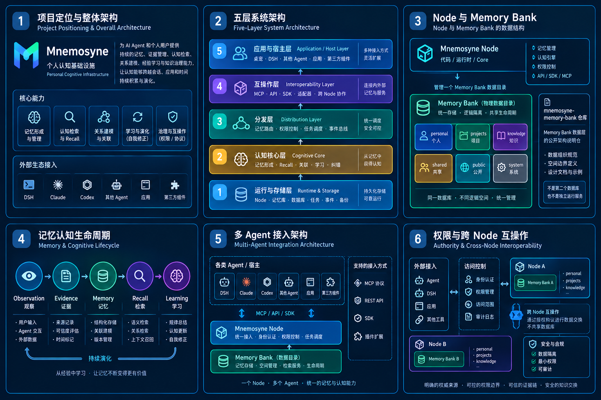
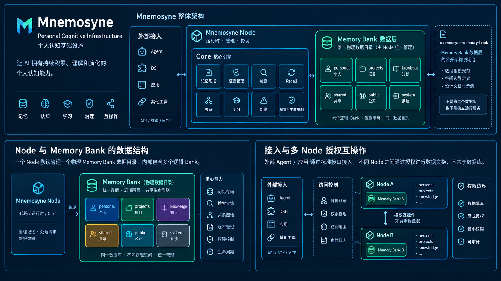

# Mnemosyne

### Modular Evolving Memory Infrastructure for AI Agents

让 Agent 不只是记住过去，而是能够理解变化、积累经验，并修正自己。

Mnemosyne 是一个面向 AI Agent 的模块化记忆基础设施。

它不排斥其他记忆系统，而是成为个人认知的权威层（Cognitive Authority Layer），通过适配器与其他记忆库协作。

它为 AI Agent 和其他智能应用提供一套独立、持久、可治理、可演化的认知能力，让它们能够积累经验、形成记忆、理解关系、检索过去、修正认知，并在时间中持续学习。

> **权威实现：** 本仓库 [`canyueY/mnemosyne`](https://github.com/canyueY/mnemosyne)。  
> **不是 2.0 标尺：** npm / GitHub 旧壳 [`dsh-mnemosyne`](https://github.com/canyueY/dsh-mnemosyne)。  
> 基线、GA 与完整文档见 [`docs/REPO_BASELINE.md`](docs/REPO_BASELINE.md)。

> **关键边界：一个 Node 一个 Memory Bank；`mnemosyne-memory-bank` 不是第二套记忆库。**
>
> - `mnemosyne`：代码、Node、Core，负责运行和认知。
> - `Mnemosyne Memory Bank`：Node 管理的**数据目录**（SQLite + runtime），不是代码仓。
> - [`mnemosyne-memory-bank`](https://github.com/canyueY/mnemosyne-memory-bank)：Memory Bank 的**公开说明仓**，不含独立数据库、不启动服务、不保存个人数据。
>
> **项目隔离用 Bank，跨设备才用多 Node；不要让两套系统同时对同一份长期认知拥有写入权。**

它希望解决的不是简单的对话历史保存问题，而是如何让 Agent 在长期运行中持续积累经验：将经历转化为证据，将证据组织成记忆，在新信息出现时更新已有认知，并通过行为结果和反馈不断改善未来的判断。

Mnemosyne 以独立运行、模块化设计、可追溯数据和可组合服务为核心原则。它可以作为独立记忆系统运行，也可以通过适配器接入 DeepSeek Harness（DSH）等 Agent 宿主。

---

## 目录

- [1. 核心思想](#1-核心思想)
- [2. 项目定位](#2-项目定位)
- [3. 核心特点](#3-核心特点)
- [4. 整体架构](#4-整体架构)
- [5. 核心实现方案](#5-核心实现方案)
- [6. 模块化设计](#6-模块化设计)
- [7. 安装与运行](#7-安装与运行)
- [8. DSH 集成](#8-dsh-集成)
- [9. 开发与测试](#9-开发与测试)
- [10. 设计边界](#10-设计边界)
- [11. 未来方向](#11-未来方向)
- [12. 项目理念](#12-项目理念)

---

## 1. 核心思想

传统 Agent Memory 通常关注两个问题：

- 保存了什么？
- 需要时能否检索出来？

Mnemosyne 希望进一步解决三个问题：

- 新经验如何改变已有记忆？
- 已有判断如何在反证出现时得到修正？
- 一次经验如何改善 Agent 下一次的判断与行动？

因此，Mnemosyne 将记忆视为一个持续演化的过程：

Experience → Evidence → Memory → Retrieval → Action → Feedback → Evolution

```text
                新经历  新信息
                       │
                       ▼
                 Observation
                       │
                       ▼
                   Evidence
                       │
                       ▼
             Candidate  Evaluation
                       │
                       ▼
                 Memory Bank
                       │
                       ▼
             Retrieval  Context
                       │
                       ▼
                 Agent Action
                       │
                       ▼
                Feedback  Outcome
                       │
                       ▼
              Schema  Memory Evolution
                       │
                       └───────► 新一轮经验
```

记忆不是静态仓库，而是一个能够随着证据变化而持续调整的系统。

### 核心原则

1. 证据优先： 记忆必须尽可能保留来源、时间和可信程度。
2. 事实与推断分离： Agent 的推测不能自动成为用户事实。
3. 变化优先于覆盖： 新信息不应无条件覆盖旧信息。
4. 可追溯： 记忆的形成、更新和失效应当能够追踪。
5. 模块独立： 每项能力具有清晰边界，避免整个系统绑定单一宿主。
6. 渐进演化： 新能力应当可以独立测试、替换和逐步接入。
7. 经验复利： 每一次有效经验都应有机会改善未来的判断。

---

## 2. 项目定位

| 属性 | 说明 |
| --- | --- |
| 项目名称 | Mnemosyne |
| 项目定位 | Evolving Memory Infrastructure |
| 项目类型 | AI Agent 记忆基础设施 |
| 核心目标 | 长期记忆、证据管理、认知演化与反馈学习 |
| 核心实现 | Node Host + Python FastAPI Service |
| 接入方向 | DSH、独立 Agent、外部应用 |
| 设计原则 | Modular、Independent、Traceable、Composable |

Mnemosyne 不试图成为一个完整的 Agent 框架。

它不负责替代模型推理、工具执行、任务编排或 Agent 人格，而是为这些系统提供可复用的记忆能力。

Agent 决定如何行动，Mnemosyne 负责让行动能够建立在可靠的历史经验之上。



*项目定位、五层系统架构、Node 与 Memory Bank、记忆认知生命周期、多 Agent 接入与跨 Node 互操作总览。*


### 2.1 官方定义：个人认知基础设施

> **Mnemosyne 是个人认知基础设施（Personal Cognitive Infrastructure）。**
>
> 它为 AI Agent 和其他智能应用提供一套独立、持久、可治理、可演化的认知能力，让它们能够积累经验、形成记忆、理解关系、检索过去、修正认知，并在时间中持续学习。
>
> **Mnemosyne is an open, independent Personal Cognitive Infrastructure for AI Agents.**

一句话定位：

> **让记忆成为认知的基础，让认知能够持续演化。**

记忆是 Mnemosyne 的基础能力，**认知**才是它要承载的整体能力。

### 2.2 它不是什么

| 定义 | 是否属于 | 原因 |
| --- | --- | --- |
| 算法插件 | 不完全是 | 算法只是内部实现，可以替换和扩展 |
| 记忆库（Memory Store） | 是，但不完整 | 需要持久化、组织和管理记忆 |
| 向量数据库 | 不是 | 向量检索只是检索手段之一 |
| RAG 系统 | 不只是 | RAG 主要解决知识检索与上下文注入 |
| Agent 插件 | 不完全是 | 插件只是接入某个宿主的方式 |
| 记忆中间件 | 部分是 | 提供统一接口，但不应只是数据转发层 |
| 认知引擎（Cognitive Engine） | 是核心组成 | 负责记忆形成、检索、关联、推理和演化 |
| 个人认知基础设施 | 最准确的整体定义 | 同时涵盖数据、认知能力、治理、运行和生态接入 |

Mnemosyne 由四部分组成，而不是四个独立产品：

1. **记忆系统**：保存什么，以及如何组织信息。
2. **认知引擎**：如何从信息中形成、检索和修正认知。
3. **运行与存储**：如何让系统独立运行、可靠持久化。
4. **治理与互操作**：谁能访问、访问什么，以及如何与外部系统协作。

### 2.3 与外部记忆系统的关系

> **会有重叠，但不必然冲突。真正的风险不是 Mnemosyne 和其他记忆库同时存在，而是它们同时对同一份记忆拥有写入权、修改权和最终解释权。**

Mnemosyne 不排斥其他记忆系统，而是成为**个人认知的权威层（Cognitive Authority Layer）**，通过适配器与其他记忆库协作。

| 关系 | 是否冲突 | 说明 |
| --- | --- | --- |
| Mnemosyne 与 Agent 自带记忆并存 | 不冲突 | Agent 可以保留自己的会话记忆和运行状态 |
| Mnemosyne 与其他记忆库互相读取 | 不冲突 | 通过授权和适配器交换信息 |
| Mnemosyne 与其他记忆库同时管理同一份长期个人认知 | 有冲突风险 | 可能产生重复记忆、版本不一致、事实矛盾和权限混乱 |

不同系统保存的内容并不相同：

| 系统 | 主要职责 | 建议关系 |
| --- | --- | --- |
| Agent 会话记忆 | 当前对话、短期上下文 | 保留在 Agent |
| Agent 工作记忆 | 当前任务状态、中间结果 | 保留在 Runtime |
| 项目知识库 | 项目文档、代码、技术规范 | 保留在原知识源 |
| 向量数据库 | Embedding 和相似度索引 | 可作为 Mnemosyne 的检索 Provider |
| Graphiti 等时序图记忆系统 | 实体关系和时间变化 | 可作为算法或存储能力接入 |
| Mem0、LangMem 等记忆方案 | 记忆提取、更新和检索 | 可作为适配对象或算法参考 |
| Mnemosyne | 个人长期认知、证据、关系、经验与治理 | 个人认知权威层 |

> **不是所有 Agent 能访问的数据，都应该被复制成 Mnemosyne 的长期记忆。**

例如，项目文档本身可以继续保存在 GitHub；Mnemosyne 只记录用户参与该项目的经历、重要决策、个人偏好，以及指向原始文档的引用。Agent 需要项目最新状态时，仍然应该回到原始文档查询。

### 2.4 权威模型：冲突由谁解释

Mnemosyne 需要明确的 **Authority Model**，不能因为自己是中心系统就直接覆盖外部数据。

| 信息 | 来源 | 状态 |
| --- | --- | --- |
| 使用 Python | 2025 年的用户表达 | 历史事实 |
| 使用 TypeScript | 2026 年的用户表达 | 当前有效事实 |
| 主要使用 Python | 另一个 Agent 的记忆 | 可能过期，待核验 |

Mnemosyne 应当负责：

1. 保存原始来源和时间。
2. 判断新旧信息之间是否存在冲突。
3. 建立历史版本和当前有效状态。
4. 记录证据和修正过程。
5. 根据授权向其他系统发布更新。

> **Mnemosyne 的权威性来自证据、用户授权和明确的治理规则，而不是来自它拥有更大的数据库。**

### 2.5 四种接入模式

| 模式 | 说明 | 适用场景 |
| --- | --- | --- |
| **A. 独立记忆**（推荐默认） | 其他记忆库独立运行，Mnemosyne 不接管 | 会话记忆、任务状态、项目缓存 |
| **B. 只读接入** | Mnemosyne 可以检索外部记忆，但不修改其内容 | 已有 Agent Memory、企业知识库 |
| **C. 双向同步** | 双方按字段、范围、版本和授权规则同步 | 用户明确授权的长期记忆迁移或协作 |
| **D. Mnemosyne 托管认知** | 外部 Agent 把长期个人认知交给 Mnemosyne，自身只保留工作状态和缓存 | 以 Mnemosyne 为主要记忆基础设施的 Agent |

这四种模式不能混为一谈。尤其是**双向同步 ≠ 双方可以无条件覆盖对方的数据**。

### 2.6 Memory Interoperability Layer

建议在 Mnemosyne 中增加一个明确的逻辑层：

> **Memory Interoperability Layer（记忆互操作层）**

它不负责记忆本身的认知判断，而负责与外部记忆系统建立可控连接。

| 模块 | 职责 |
| --- | --- |
| Memory Provider Registry | 登记外部记忆系统 |
| Memory Adapter | 转换外部数据结构 |
| Identity Mapping | 映射用户、Agent、Node 身份 |
| Scope Mapping | 映射 Memory Bank 和外部命名空间 |
| Authority Resolver | 判断数据的权威来源 |
| Conflict Resolver | 检测和处理记忆冲突 |
| Sync Coordinator | 增量同步、版本管理和重试 |
| Provenance Tracker | 保存来源、证据和变更历史 |
| Permission Gateway | 控制读取、写入、同步和撤销 |

```text
Agent A Memory
Agent B Memory
External Knowledge
Other Memory Store
        │
        ▼
Memory Interoperability Layer
Adapter · Identity · Permission · Provenance · Conflict · Sync
        │
        ▼
Mnemosyne Cognitive Core
Evidence · Memory · Relationship · Recall · Learning · Governance
```

**外部系统通过受控接口协作，不直接访问核心数据库。**

### 2.7 必须坚持的五条原则

1. **不强制替换**：外部记忆库可以继续存在。
2. **不默认复制**：外部信息先作为外部数据或 Observation，不自动成为个人事实。
3. **不允许双重权威**：同一认知对象必须明确权威来源和写入规则。
4. **不丢失来源**：同步后的记忆仍然能够追溯到原始系统和证据。
5. **不默认共享**：一个 Agent 的私人记忆不能因为接入 Mnemosyne 就自动对其他 Agent 可见。

### 2.8 最终定位

> **Mnemosyne 是个人认知基础设施，也是个人长期认知的权威管理层。**  
> 它不要求取代所有外部记忆系统，而是通过开放协议连接、整合和治理它们，使个人认知能够跨 Agent、跨应用、跨时间持续积累与演化。

**Mnemosyne 不是要成为世界上唯一的记忆库，而是要成为用户自己的认知中心。**

其他系统可以有自己的记忆，但用户的长期个人认知由谁负责、依据什么更新、如何纠错、谁可以访问，应当有清晰且可迁移的规则。

> 记忆互操作层与权威模型纳入 Mnemosyne 2.0 架构设计；跨 Node 的联邦同步继续放在后续阶段，不因此扩大 2.0 GA 范围。

### 2.9 层级关系

| 名称 | 定义 | 与 Mnemosyne 的关系 |
| --- | --- | --- |
| Mnemosyne | 个人认知基础设施 | 整体系统 |
| Mnemosyne Node | 独立运行的认知节点 | 部署和运行实体 |
| Mnemosyne Core | 认知与记忆核心能力 | 核心引擎 |
| Memory Bank | 具有独立边界的记忆空间 | 记忆组织与隔离机制 |
| Cognitive Algorithm | 检索、归纳、关联、学习等算法 | 可替换的内部实现 |
| Adapter / Plugin | 外部系统接入适配器 | 扩展和集成方式 |
| SDK / API / MCP | 外部调用接口 | 互操作入口 |

> **Mnemosyne ≠ Mnemosyne Node ≠ Memory Bank。**  
> Mnemosyne 是整套基础设施；Node 是一次独立运行实例；Memory Bank 是 Node 内部的逻辑记忆空间。

### 2.10 运行时边界：一个 Node，一个 Memory Bank

| 层 | 实体 | 是否独立存储 | 说明 |
| --- | --- | --- | --- |
| 代码 | `canyueY/mnemosyne` | 否 | Node / Core / API / SDK |
| 运行 | Mnemosyne Node | 是，一个 Node 一个数据根 | 进程、配置、事务、任务 |
| 数据 | Mnemosyne Memory Bank | 是，Node 的物理数据目录 | SQLite、runtime、logs、components |
| 逻辑 | Personal / Projects / Knowledge / Shared / Public / System | 否，同一数据库内的 Bank | 权限、检索范围、隔离 |
| 文档 | `canyueY/mnemosyne-memory-bank` | 否 | 架构与数据契约说明，不是运行时 |

**同一 Node 内：**

- 不同项目用不同 Bank，不复制数据库；
- 默认检索只查 `personal`；
- `shared` / `public` 不会被自动带进 `personal`；
- 需要显式指定 `banks` 才能跨空间检索。

**不同 Node 之间：**

- 不共享同一个 SQLite；
- 通过 API / SDK / MCP / 导入导出交换；
- 同一认知必须有明确权威来源，不能双写；
- 跨 Node 联邦按规划放在 2.1+。

推荐形态：

```text
一个用户
  └─ 一个 Mnemosyne Node
       └─ 一个 Memory Bank
            ├─ personal
            ├─ projects
            └─ knowledge
```

> **`mnemosyne` 有记忆库，`mnemosyne-memory-bank` 没有独立记忆库。**  
> 两者逻辑上重合、可以关联，但不应该各自维护一套数据库。


---

## 3. 核心特点

### 3.1 基础设施优先

Mnemosyne 不将自身限制为某个 Agent 框架的附属插件。

它以独立服务为核心，将记忆处理、存储、检索和演化能力封装为可复用的基础设施。

这意味着：

- 不要求 Agent 与记忆系统使用同一种语言。
- 不要求所有调用者都运行在同一个进程中。
- 不要求记忆能力只能通过某个插件入口访问。
- 不要求未来新增的 Agent 框架重新实现一套记忆系统。

DSH 是重要的集成宿主，但不是 Mnemosyne 唯一的使用方式。

### 3.2 模块化与独立运行

每项能力尽量拥有明确的输入、输出和职责。

例如：

- Schema Evolution 可以独立处理图式演化。
- Feedback Learning 可以独立评估反馈信号。
- Semantic Retrieval 可以独立提供语义相关性信号。
- Memory Bank 负责记忆数据的组织和管理。

模块之间通过明确的数据契约协作，而不是依赖彼此的内部实现。

### 3.3 记忆具有生命周期

一条信息不应该只有内容，还应该有来源、状态和变化过程。

Mnemosyne 将记忆相关过程组织为：

Observation → Evidence → Candidate → Memory → Review → Evolution

让系统能够区分：

- 新出现的信息。
- 已经验证的事实。
- 尚待确认的候选判断。
- 与旧记忆存在冲突的信息。
- 已经失效或被新状态取代的信息。

### 3.4 认知演化

基于图式理论，Mnemosyne 将新经验与既有认知之间的关系分为：

| 类型 | 含义 |
| --- | --- |
| Assimilation | 同化：新经验可以纳入既有图式 |
| Accommodation | 顺应：调整既有图式的内容或适用范围 |
| Conflict | 冲突：反证足以使图式进入争议状态 |

当前实现由 `cognition/schema_evolution.py` 提供。

其中，默认 `confirm=False`，先预览演化结果，确认后才写入版本，避免新证据静默覆盖已有认知。

### 3.5 反馈驱动的学习

Mnemosyne 不把所有反馈混为一谈。

当前将反馈区分为：

| 信号 | 含义 | 权重 |
| --- | --- | ---: |
| `user_explicit` | 用户明确表达的评价或纠正 | 0.10 |
| `outcome` | 实际行为结果 | 0.06 |
| `self_eval` | Agent 自我评估 | 0.02 | 

三种信号具有不同的证据意义。

尤其是 Agent 自评不能直接改变用户事实；负向信号可以要求后续 Review 或 Change Plan 介入。

对应实现：`cognition/feedback_learning.py`。

### 3.6 可选语义能力

语义检索是可插拔能力，不是记忆系统唯一的判断依据。

当前实现：

- 默认使用轻量级 `hashed_embedding()`。
- 允许注入真正的 `EmbeddingProvider`。
- 通过 `SemanticScorer.blend()` 融合词法与语义信号。
- 语义加分权重上限为 0.6。
- 不替代原有 FTS、Planner 和证据、时间、情境评分。

对应实现：`retrieval/semantic.py`。

默认哈希表示是轻量级相似性特征，并不等价于完整的自然语言语义理解。

---

## 4. 整体架构



*外部接入 → Mnemosyne Node / Core → Memory Bank 数据层；不同 Node 之间通过授权互操作，不共享数据库。*

Mnemosyne 采用 Host 与 Service 分离的架构思路。

```text
                 Agent  Application
                         │
                         ▼
                  Integration Layer
                   DSH  REST  MCP
                         │
                         ▼
                    Node Host
                         │
                Service Integration
                         │
                         ▼
                 Python Memory Service
                         │
          ┌──────────────┼──────────────┐
          ▼              ▼              ▼
       Cognition      Retrieval       Memory
          │              │              │
          ▼              ▼              ▼
    Schema Evolution  Semantic       Memory Bank
    Feedback Learning  Scoring       Evidence
    Change Planning    Ranking        History
                         │
                         ▼
                 Persistent Storage
```

### Node Host

负责宿主集成和服务调用。

主要目标：

- 提供统一的应用接入入口。
- 管理宿主侧生命周期。
- 连接独立记忆服务。
- 将底层能力适配为 Agent 可使用的接口。

### Python Memory Service

负责记忆核心处理能力。

主要目标：

- 记忆数据处理。
- 证据与状态管理。
- 认知演化。
- 反馈学习。
- 检索与评分。
- 与存储层协作。

### Memory Bank

负责长期记忆的组织与持久化。

它不应该依赖某一个 Agent 的运行状态，也不应该将所有数据直接绑定到单次对话上下文。

---

## 5. 核心实现方案

### 5.1 Observation → Evidence → Candidate

系统首先接收观察信息，再将其组织为可评估的证据。

这一步重点是保留来源和上下文，而不是急于生成结论。

### 5.2 Memory Evolution

当新信息进入系统时，与现有记忆进行匹配。

根据证据关系决定：

- 补充旧记忆。
- 调整旧记忆的适用范围。
- 创建新版本。
- 标记冲突。
- 提交人工或后续流程审查。

### 5.3 Feedback Learning

行为结果和用户反馈分别进入学习过程。

系统需要区分：

- 用户明确认可。
- 用户明确纠正。
- 实际行动成功。
- 实际行动失败。
- Agent 自我判断。

这样可以避免把一次成功执行错误地解释为用户认同。

### 5.4 Semantic Retrieval

语义信号参与检索排序，但不能压过证据可靠性、时间有效性和情境匹配。

未来可以根据实际需求注入不同的 Embedding Provider，而无需重写整个检索系统。

### 5.5 Experience Loop

最终形成：

```text
Experience
    ↓
Evidence
    ↓
Memory
    ↓
Recall
    ↓
Action
    ↓
Feedback
    ↓
Evolution
    └───────────────↺
```

这条闭环是 Mnemosyne 的长期核心。

---

## 6. 模块化设计

Mnemosyne 希望将能力设计成可独立维护的模块。

| 模块 | 职责 |
| --- | --- |
| Observation | 接收原始观察 |
| Evidence | 管理证据及其来源 |
| Memory | 记忆生命周期管理 |
| Schema Evolution | 图式同化、顺应与冲突处理 |
| Feedback Learning | 用户反馈、结果和自评信号 |
| Retrieval | 记忆召回与排序 |
| Semantic | 语义相关性信号 |
| Memory Bank | 记忆存储与命名空间组织 |
| Integration | DSH 和其他宿主的适配 |

模块化的目标不是拆出尽可能多的文件，而是让模块具备独立演进的能力。

未来可以替换某个模块，而不必重写整个系统。

---

## 7. 安装与运行

### 环境要求

- Node.js 20+
- Python 运行环境
- Git
- 对应 Python 服务所需的依赖

### 获取项目

```bash
git clone https://github.com/canyueY/mnemosyne.git
cd mnemosyne
```

### 安装 Node 侧依赖

```bash
npm install
```

### Python 服务环境

建议使用独立虚拟环境：

```bash
python -m venv .venv
```

Windows：

```powershell
.venv\Scripts\activate
```

Linux / macOS：

```bash
source .venv/bin/activate
```

根据仓库提供的 Python 依赖清单安装服务端依赖。

### 启动方式

Mnemosyne 的运行由 Node Host 与 Python Service 两部分组成。

实际启动脚本、服务地址、环境变量和配置文件应以当前版本仓库中的配置为准。

不要将开发环境中的默认路径和端口直接当作生产环境配置。

 注意：以上为环境准备流程。完整的一键启动命令应在仓库统一启动脚本和服务配置稳定后补入。

---

## 8. DSH 集成

Mnemosyne 提供独立的 DSH 插件接入层。

插件仓库：

https://github.com/DSH-Raising-Plan/dsh-mnemosyne

安装：

```bash
dsh plugin --profile web add github:DSH-Raising-Plan/dsh-mnemosyne#main
```

目前可通过插件入口使用记忆能力，例如：

- `memory_search`
- `memory_context`
- `memory_observe`
- `memory_feedback`

插件负责将 DSH 的调用适配到 Mnemosyne 的记忆能力，不应成为记忆核心逻辑唯一的实现位置。

核心实现与宿主插件保持分离，有利于未来接入其他 Agent 框架。

---

## 9. 开发与测试

Mnemosyne 的开发强调模块级测试与完整回归。

当前经验闭环新增测试：

```text
tests/unit/test_experience_loop.py
```

覆盖：

- 图式演化。
- 反馈学习。
- 语义信号。
- 相关边界行为。

经验闭环提交：

```text
6ce80db
feat: add experience loop
```

当时独立仓全量测试结果：

```text
119 passed
```

测试数量和结果会随项目持续变化，请以当前 CI 和最新提交为准。

开发原则：

1. 新模块必须具有清晰的输入和输出。
2. 重要状态变化必须有测试。
3. 不允许自评直接改变用户事实。
4. 默认采用保守写入策略。
5. 新能力不能破坏既有记忆契约。
6. 接口变更需要考虑向后兼容。

---

## 10. 设计边界

Mnemosyne 当前不试图实现所有心理学理论。

暂不进入主干的方向包括：

- 社会学习四过程的完整模型。
- 道德发展三水平六阶段。
- 完整的心理空间建模。
- 复杂的自主意识模拟。

这些理论可以成为未来的研究参考，但不应为了理论完整而牺牲工程可维护性。

同时，Mnemosyne 本身不代表 Agent 拥有意识或真实情感。

它提供的是可追溯的经验组织、认知更新和反馈机制。

---

## 11. 未来方向

### P0 — Core Infrastructure Stabilization

- 统一核心数据契约。
- 完善服务生命周期。
- 增强事务、幂等与错误恢复。
- 完善模块独立测试。
- 明确服务版本和接口兼容策略。

### P1 — Experience Loop Integration

- 将图式演化接入真实记忆生命周期。
- 将反馈学习与 Recall、Review、Change Plan 联动。
- 验证经验是否实际改善后续检索和行为。
- 建立端到端经验闭环测试。

### P2 — Universal API  SDK

- 统一 REST API。
- SDK。
- MCP Adapter。
- 其他 Agent 框架适配器。

这些属于后续接口建设，不应与当前已完成的服务层能力混淆。

### P3 — Advanced Retrieval

- 更成熟的 Embedding Provider。
- 混合检索优化。
- 多信号校准。
- 语义关联与跨项目检索。

### P4 — Memory Federation

- 多实例协作。
- 跨节点同步。
- 记忆授权与共享。
- 可验证的迁移与恢复。

---

## 12. 项目理念

Mnemosyne 希望探索一种新的 Agent 记忆基础设施：

不是让 Agent 永远保存更多内容，而是让它能够在合适的时间找到正确的证据，理解经验的变化，并在新证据出现时修正过去的判断。

记忆的价值不在于存储了多少，而在于它能否让未来变得更好。

项目：

- 核心实现：https://github.com/canyueY/mnemosyne
- DSH 插件：https://github.com/DSH-Raising-Plan/dsh-mnemosyne

