# Mnemosyne

[English](README.en.md) | **简体中文**

### DSH Evolving Memory System

**DSH 演化记忆系统**

> 从记住信息，到理解变化；从检索过去，到延续关系。

Mnemosyne (`dsh-mnemosyne`) 是面向 DSH（DeepSeek Harness）的统一记忆基础设施，旨在为长期陪伴、持续学习、个体化理解和社会关系演化提供可靠、可追溯、可纠正的记忆能力。

> **更名说明**：本项目由 `dsh-cognitive-memory` 更名而来。旧配置键、旧环境变量与旧数据目录仍保留迁移兼容；安装时请使用新的 `dsh-mnemosyne`。

传统记忆系统往往关注：**存储了什么，以及能否在需要时找回来。**

Mnemosyne 希望进一步回答：

- 这条信息在什么时候成立？现在仍然成立吗？
- 这条判断来自直接观察、明确表达，还是模型推断？
- 同一件事在不同时间、空间与关系情境下，意味着什么？
- 当新证据与旧记忆冲突时，应该如何更新，而不是简单累积？
- 一次情绪化事件是短期状态，还是可能影响长期关系的经验？
- 过去的共同经历，如何帮助 DSH 更好地理解现在？

Mnemosyne 的核心目标不是单纯扩大记忆容量，而是让记忆具有**时间性、情境性、可追溯性、可演化性和可纠错性**。

## 一眼看懂：从存储到演化

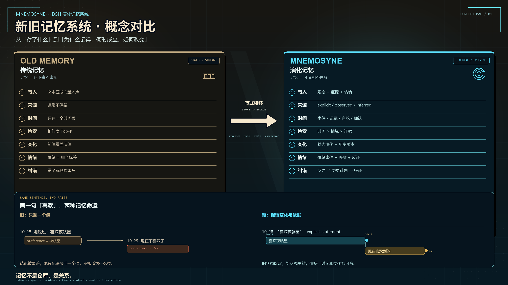

*左：传统记忆——记住结论；右：Mnemosyne——记住证据、时间与变化。*

---

---

## 目录

- 1\. 为什么 DSH 需要 Mnemosyne
- 2\. 项目定位与设计原则
- 3\. 整体技术路线
- 4\. 核心能力
- 5\. 时间、空间与情绪
- 6\. 记忆如何工作
- 7\. 技术实现思路
- 8\. 与其他记忆项目的区别
- 9\. 相比早期版本的更新
- 10\. 在 DSH 中的作用
- 11\. 发展路线图
- 12\. 评估标准
- 13\. 设计边界与隐私
- 14\. 项目信息

---

## 1. 为什么 DSH 需要 Mnemosyne

DSH 不只是一个问答系统。它希望构建一个能够持续参与数字社会、积累经验、发展兴趣、维持关系并根据反馈调整行为的 Agent 生态。

在这样的系统中，记忆不应只是对话结束后留下的一组事实。

如果 Agent 只记得某人喜欢什么，却不知道这个偏好何时形成、是否已经改变、来自谁的表达，那么它可能长期使用过期信息。

如果 Agent 记得发生过一次争执，却没有保留当时的情境、双方表达、后续结果和不确定性，那么一次事件就可能被错误地固化为对某个人的长期判断。

如果 Agent 只保留结果，却没有保留来源、过程与反例，那么后续的学习与反思就很难建立在可靠证据之上。

Mnemosyne 因此将记忆视为一个持续演化的过程：

**观察 → 形成证据 → 建立关联 → 生成候选记忆 → 验证与整合 → 检索与应用 → 接收新证据 → 重新评估**

它为 DSH 提供的是持续理解世界与关系的基础设施，而不是替 Agent 决定所有事情。

## 2. 项目定位与设计原则

### 项目定位

| 项目属性       | 定义                          |
| ---------- | --------------------------- |
| 正式名称       | Mnemosyne                   |
| 英文定位       | DSH Evolving Memory System  |
| 中文定位       | DSH 演化记忆系统                  |
| 仓库 / 插件 ID | `dsh-mnemosyne`             |
| 所属生态       | DSH（DeepSeek Harness） |
| 核心职责       | 统一管理记忆证据、时间状态、情境关联、记忆演化与纠错  |
| 长期目标       | 为长期陪伴、个体化理解和持续学习提供可靠的记忆基础   |

### 核心设计原则

**1. 一个统一的长期记忆系统**

Mnemosyne 是 DSH 现有 Memory 插件的演化方向，而不是另一个与原有 Memory 并行的个人记忆系统。

情绪、时间、空间、行为和关系等能力应纳入统一的记忆生命周期，避免形成多个互相矛盾的个人画像与记忆来源。

**2. 事实与解释分离**

“观察到什么”与“认为这意味着什么”必须区分。

直接观察、当事人自述、外部来源和模型推断应保留不同的来源标识。推断可以被修正，不能悄悄升级成事实。

**3. 记忆具有时间范围**

记忆不只是一个值，还应描述它何时发生、何时被记录、在什么时间范围内有效，以及最近一次何时得到确认。

**4. 允许变化、冲突和未知**

新信息不应无条件覆盖旧信息。系统需要识别状态变化、保留必要的历史关系，并允许暂时无法确定答案。

**5. 记忆服务于 Agent，而不是替代 Agent**

Mnemosyne 负责组织证据、维护记忆状态、提供相关历史并指出不确定性。DSH Agent 负责决定如何使用这些信息、是否进一步探索以及采取什么行动。

**6. 可验证优先于表面上的智能**

记忆是否正确、是否能够纠错、是否减少误判，比系统能生成多少看似合理的个人描述更加重要。

---

## 3. 整体技术路线

Mnemosyne 的整体路线是从以信息存储和检索为中心的记忆系统，逐步发展为以证据、状态演化和长期连续性为中心的记忆基础设施。

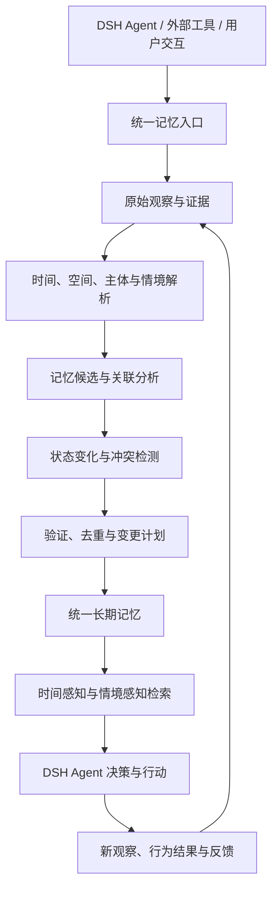

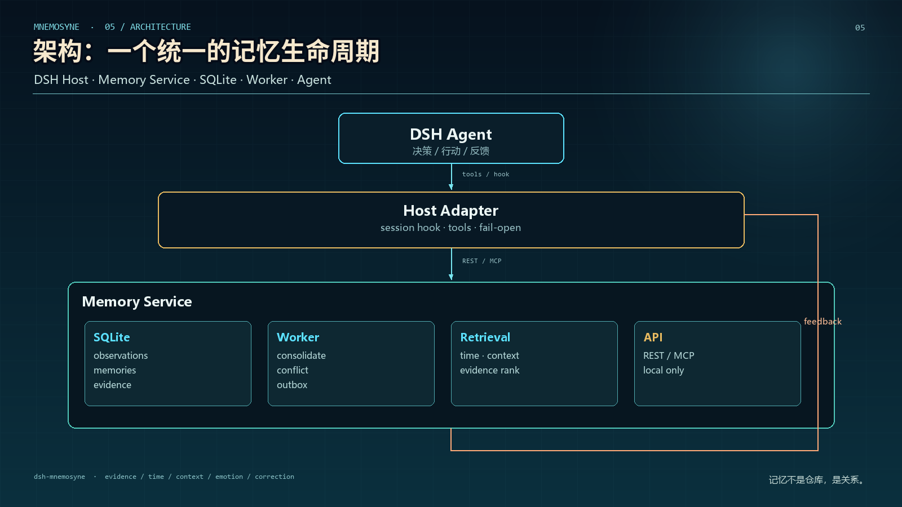

*DSH Host、Memory Service、SQLite、Worker 与 Agent 之间的统一生命周期。*

### 三个核心层次

#### 第一层：记忆事实与证据

记录发生了什么、谁表达了什么、信息从哪里来，以及系统实际观察到了什么。

#### 第二层：记忆状态与关系

描述信息的有效时间、变化过程、相关实体、情境条件、支持证据与冲突。

#### 第三层：记忆演化与应用

根据新证据调整旧判断，向 Agent 提供适用的历史信息，并通过后续结果持续改进记忆质量。

这三层共同构成一个反馈闭环。

Mnemosyne 不应因为加入了更多维度，就把所有信息都转化为复杂的心理或因果解释。只有在证据足够时才进行更深入的推断；否则保留事实和未知状态本身就是正确结果。

---

## 4. 核心能力

### 4.1 时间感知记忆

普通记忆通常记录信息及其写入时间。Mnemosyne 的目标是进一步区分：

- **事件时间**：事情实际发生的时间。
- **记录时间**：系统获知或写入信息的时间。
- **有效时间**：信息被认为成立的时间区间。
- **确认时间**：信息最近一次得到支持的时间。
- **时间精度**：精确时间、估计区间或未知。

这使系统能够区分历史事实、当前状态、计划和过期信息。

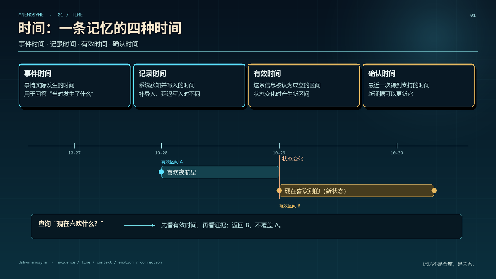

*事件时间、记录时间、有效时间、确认时间，让“过去成立”和“现在有效”分开。*

例如：

> 某人过去喜欢某类作品，但最近明确表示兴趣已经变化。

系统不应简单地把两条信息合并成矛盾标签，而应尽可能保留偏好变化的时间线，并在查询当前偏好时优先考虑最新且适用的证据。

### 4.2 证据追溯

每条重要记忆都应尽可能保留来源和证据引用。

建议区分：

- `explicit_statement`：当事人明确表达。
- `direct_observation`：直接观察到的事实。
- `external_source`：外部来源提供的信息。
- `model_inference`：模型根据现有证据作出的推断。
- `later_confirmation`：后续得到确认的信息。
- `counter_evidence`：与当前判断相冲突的证据。

这些是建议的逻辑分类，实际枚举值应与仓库中的数据模型保持一致。

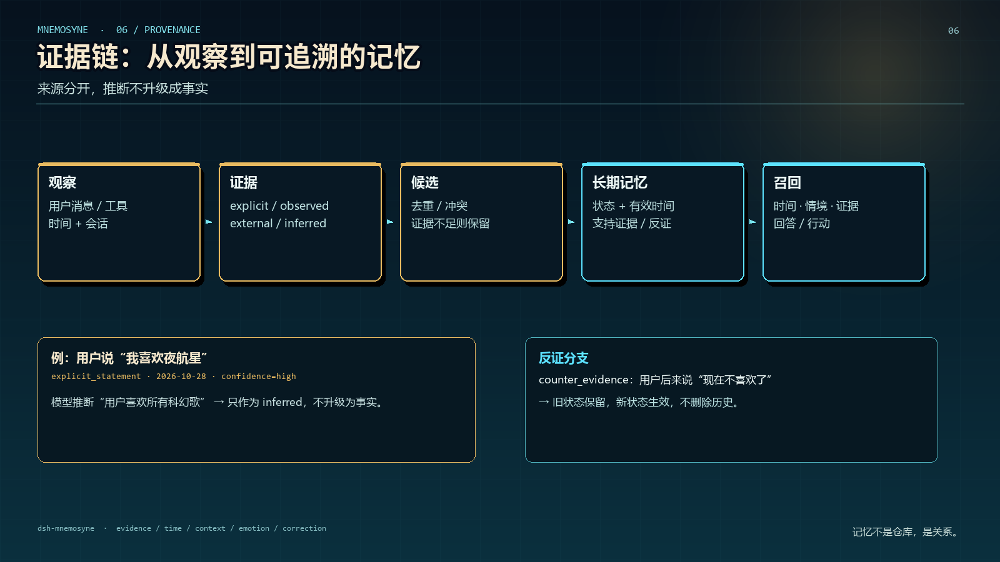

*从观察、证据、候选到长期记忆和召回；推断不会悄悄升级成事实。*

证据追溯可以让 DSH 不仅知道某条信息，还能回答：它为什么存在、可靠程度如何，以及什么新证据可能改变它。

### 4.3 状态演化与冲突处理

记忆中的事实、偏好、计划、关系和行为模式都可能发生变化。

Mnemosyne 的设计目标包括：

- 检测新旧信息是否指向同一实体和同一主张。
- 区分补充信息、状态变化、真正冲突和无关信息。
- 保留必要的历史版本与修正关系。
- 避免重复记忆不断堆积。
- 允许明确纠正覆盖错误推断。
- 在证据不足时保留冲突，而不是强行给出唯一答案。

状态变化并不等于历史信息无效。例如，当前状态发生变化，不意味着过去的状态从未成立。

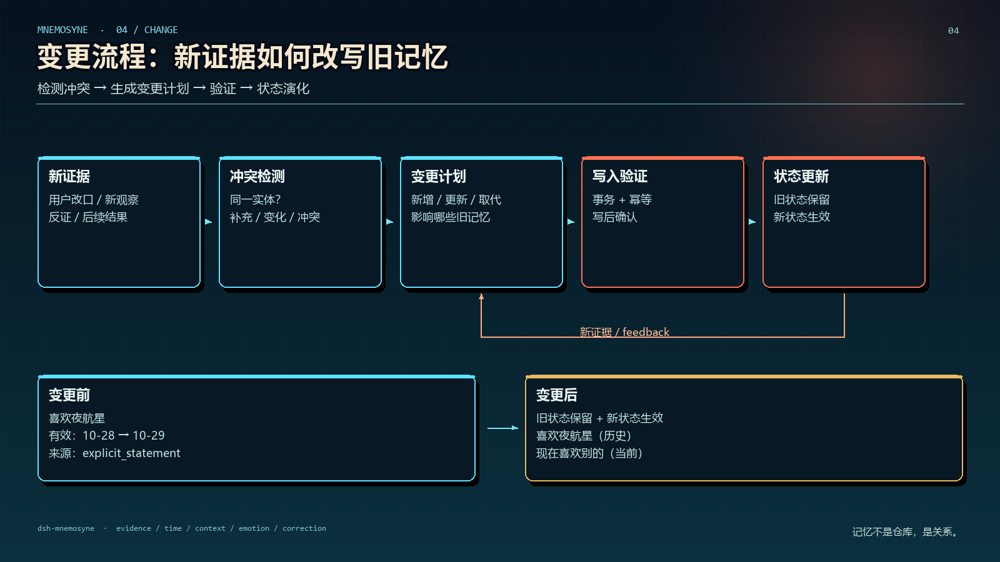

*新证据不会直接覆盖旧值：冲突检测 → 变更计划 → 写入验证 → 状态演化。*

### 4.4 情境与关系关联

相同的信息在不同情境中可能具有不同意义。

Mnemosyne 希望在已有实体和记忆关联机制的基础上，逐步支持：

- 人物、事件、项目和关系之间的关联。
- 行为发生时的任务、环境和关系背景。
- 不同时间段的行为变化。
- 相关事件的历史检索。
- 情境相似性与差异性判断。

关联只能说明信息之间存在联系，不能仅凭共同出现或时间接近就推断因果关系。

### 4.5 情绪状态与情绪事件

情绪被视为记忆中的一个重要维度，而不是对人的固定标签。

设计目标包括：

- 允许多种情绪同时存在。
- 分别记录情绪强度、判断置信度和不确定性。
- 描述情绪状态随时间的变化。
- 记录具有长期价值的情绪化事件。
- 建立带有证据、反例和适用条件的个体化情绪—行为模式。
- 在新证据出现后重新评估过去的判断。

例如，一个人在某次争执中表现出强烈的不满，随后主动解释和修复关系。系统应尽可能保留事件背景、实际表达、可能的情绪状态和后续结果，而不是把该事件简化为“这个人容易愤怒”。

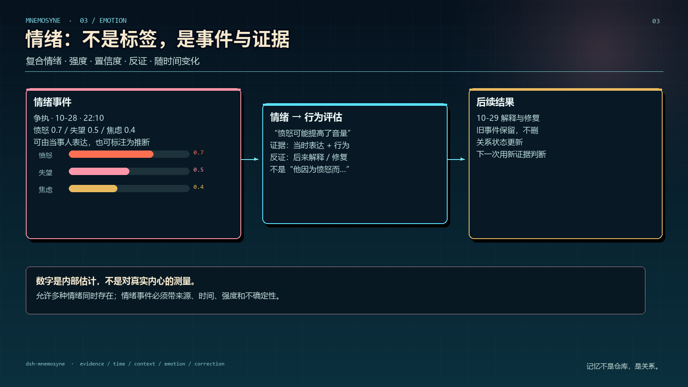

*复合情绪、强度、置信度、反证和后续结果，都进入同一套记忆。*

### 4.6 时间感知检索

检索不应只判断“哪条记忆和查询最相似”，还应考虑：

- 查询针对过去还是现在。
- 记忆在目标时间是否有效。
- 来源是否可靠。
- 是否存在更新或取代它的证据。
- 当前情境与历史情境是否相似。
- 是否存在尚未解决的冲突。

这有助于减少过期信息误用，并使 DSH 能够更准确地回顾共同经历和关系变化。

### 4.7 可解释的记忆更新

对重要的记忆变更，建议先生成可审查的变更计划，再执行写入。

变更计划应说明：

- 新增、更新、合并或取代了什么。
- 修改依据是什么。
- 影响了哪些现有记忆。
- 是否存在反证和不确定性。
- 写入后如何验证。
- 失败时如何重试或回滚。

这让记忆更新从不可见的文本修改，转向可追踪的状态演化。

---

## 5. 时间、空间与情绪

时间、空间和情绪不是三个互不相关的标签，而是理解具体事件的重要上下文。

### 5.1 时间维度

时间用于区分事件发生顺序、持续时长、状态变化和信息有效性。

系统需要尽可能识别：

- 事件何时发生。
- 状态何时开始和结束。
- 变化发生在什么时候。
- 某条信息在查询目标时间是否成立。
- 新证据是否要求重新评估旧记忆。

### 5.2 空间维度

空间信息用于记录事件发生的地点、环境或场景，以及这些信息与其他记忆之间的关联。

空间信息应遵循来源约束：

- 只有实际观察到或明确提供的信息才能作为空间事实。
- 无法确定的地点应保持未知。
- 不应根据浏览器活动、网络环境或模糊线索推断用户的精确位置。
- 空间关联不能单独证明行为原因。

空间上下文可以帮助系统区分不同场景下的经验，但不应成为不必要的个人位置追踪机制。

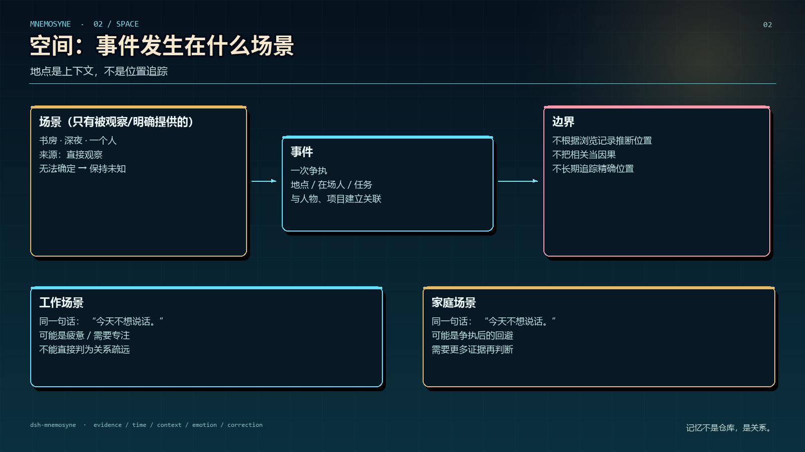

*地点是上下文，不是位置追踪；无法确定的位置保持未知。*

### 5.3 情绪维度

情绪用于描述事件发生时可能存在的复合主观状态及其变化。

建议区分：

1. 基础情绪向量，例如喜悦、悲伤、愤怒、焦虑、恐惧、失望、内疚、好奇和亲近感。
2. 状态变量，例如整体情感方向、唤醒程度、压力和不确定性。
3. 个体化反应模式，例如某人在特定情境下的典型行为变化。
4. 情绪—行为关联评估，例如情绪是否可能影响了某次表达或决定。

每种情绪的强度可以独立使用 `0–1` 区间表示，不要求所有情绪的强度总和为 1。

但量化分数只是系统内部的估计，不代表对人的真实内心状态进行精确测量。

### 5.4 三个维度如何共同工作

假设发生了一次社交争执：

- **时间**：争执何时发生，情绪是否持续，以及之后是否出现缓和。
- **空间 / 情境**：争执发生于什么场景，双方处于什么互动环境。
- **情绪**：哪些感受由当事人明确表达，哪些只是模型推测。
- **行为**：实际发生了什么，行为是否与历史模式相符。
- **后续结果**：是否出现解释、道歉、关系修复或进一步冲突。

最终得到的不是一句“他因为愤怒而做了某事”，而是一组可以追溯、比较和修正的证据与关联判断。

这也是 Mnemosyne 希望实现的核心能力：让记忆能够表达事件的复杂性，同时保留推断边界。

---

## 6. 记忆如何工作

Mnemosyne 的目标处理流程如下。

### 6.1 观察与记录

从 DSH Agent、交互工具和获准的数据来源接收信息，记录必要的事实、来源、时间和主体引用。

原始观察的可靠持久化应优先于后续的语义推理，避免推理失败导致输入丢失。

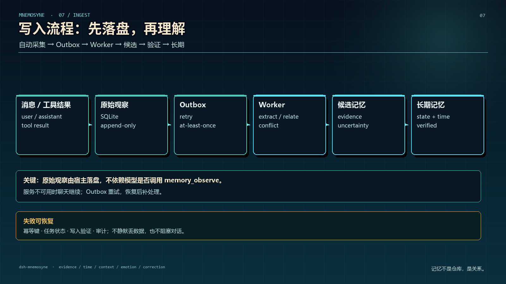

*原始观察先落盘，再进入 Outbox / Worker；写入不依赖模型是否调用 `memory_observe`。*

### 6.2 提取与关联

识别可能值得保留的事实、事件、状态变化、情绪证据和关系关联。

此阶段生成的是候选结果，不应直接把所有推断写成确定的长期记忆。

### 6.3 评估与整合

将候选信息与现有记忆进行比较，识别重复、冲突、变化和适用范围。

对于重要变更，先生成变更计划，再根据现有记忆的准入规则执行整合。

### 6.4 持久化与验证

写入后确认结果确实保存，并保证重复任务不会创建重复记忆。

对于暂时无法确认的信息，保留候选状态或不确定性，而不是强行整合。

### 6.5 检索与使用

DSH Agent 根据当前任务检索适用的历史记忆，并结合时间有效性、证据质量和情境差异进行判断。

Mnemosyne 提供记忆与证据，不代替 Agent 进行所有决策。

### 6.6 反馈与重新评估

当出现新的自述、后续结果、相反证据或相似事件时，重新评估受到影响的记忆。

这一过程让记忆能够随经验演化，而不是只增不减地堆积。

---

## 7. 技术实现思路

Mnemosyne 的实现重点是可靠的记忆生命周期，而不是为每个新概念单独建立一套存储系统。

### 7.1 统一的存储与生命周期

长期个人记忆由现有 Memory 插件统一管理。

时间、空间、情绪和行为关联属于同一记忆体系中的扩展维度，不应形成彼此独立的个人记忆来源。

如果现有架构已经提供实体、事件、时间字段、证据引用或冲突处理机制，应优先复用。

### 7.2 事务与异步处理

在现有实现适用的情况下，可以使用事务与 Outbox 模式连接原始观察和异步处理任务。

建议流程：

1. 可靠持久化原始观察。
2. 创建可重试的处理任务。
3. 由 Worker 执行情绪、时间和关系分析。
4. 生成候选记忆及变更计划。
5. 调用现有记忆写入接口。
6. 验证写入结果并更新任务状态。

具体是否采用 SQLite、Outbox、现有 Worker 或其他实现，应以仓库中的真实架构为准。

### 7.3 逻辑数据模型

可根据现有数据模型逐步映射以下逻辑对象：

| 逻辑对象                        | 作用                     |
| --------------------------- | ---------------------- |
| `MemoryEvidence`            | 保存事实来源、证据类型、时间和可信度信息   |
| `MemoryState`               | 表达事实、偏好或状态在特定时间范围内的有效性 |
| `EmotionalEvent`            | 表达情绪相关事件、行为、上下文和后续结果   |
| `EmotionBehaviorAssessment` | 保存情绪与行为关联的评估、反证和不确定性   |
| `EmotionBehaviorPattern`    | 保存带有适用情境和支持证据的个体化反应模式  |
| `MemoryChangePlan`          | 描述记忆新增、更新、合并、取代和验证过程   |

这些名称表示逻辑职责，不意味着仓库必须存在同名类或数据库表。

### 7.4 可验证与可恢复

关键写入流程应具备：

- 稳定的幂等标识。
- 可追踪的任务状态。
- 失败重试。
- 写入后验证。
- 变更记录。
- 可控的功能开关。
- 不破坏原有记忆的回滚方式。

### 7.5 渐进式实现

新增能力应先在候选层和影子评估中验证，再逐步开放正式写入与 Agent 检索。

这样可以在发现情绪误判、时间解析错误或冲突处理缺陷时，避免错误信息污染长期记忆。

---

## 8. 与其他记忆项目的区别

Mnemosyne 并不是第一个尝试让 AI 记住长期信息的项目。它的定位应当建立在现有记忆技术的基础上，而不是通过贬低其他项目来证明自身价值。

### 8.1 相关项目对比

| 项目                                         | 主要关注点                     | Mnemosyne 的差异化方向                          |
| ------------------------------------------ | ------------------------- | ----------------------------------------- |
| [Mem0](https://github.com/mem0ai/mem0)     | 面向 AI 应用的记忆提取、存储、实体关联与检索  | 更强调 DSH 中的统一记忆生命周期、情境化状态演化与陪伴连续性          |
| [Letta](https://github.com/letta-ai/letta) | 有状态 Agent、持久化记忆、记忆维护与持续学习 | 更聚焦 DSH 的统一个人记忆体系，以及时间、空间、情绪和关系事件的协同建模    |
| [Character.AI](https://character.ai/)      | 面向角色对话的长期上下文、关键事实与故事记忆体验  | 更偏向作为 DSH 后端的可追溯、可纠错记忆基础设施，而非单一对话产品中的记忆功能 |
| Mnemosyne                                  | 面向 DSH 的演化记忆基础设施          | 将证据、有效时间、状态变化、情绪事件和后续纠错整合进统一的记忆演化路线       |

以上是项目定位层面的比较，不是完整的功能对照，也不代表其他项目不具备时间感知、关系关联或长期记忆能力。

相关项目的具体能力会持续变化，正式发布时应以其最新文档为准。

### 8.2 Mnemosyne 希望重点解决的问题

#### 从静态事实走向状态演化

不仅记住一个人当前是什么状态，还要能够描述状态何时变化、依据是什么，以及历史状态是否仍适用。

#### 从记忆检索走向证据追溯

不只返回一条记忆，还尽可能解释它来自哪里、可信度如何，以及是否存在相反证据。

#### 从单次情绪标签走向复合情绪事件

允许多种情绪同时存在，并将事件背景、实际行为、后续结果和个体化反应模式关联起来。

#### 从被动保存走向反馈驱动的修正

新证据不仅可以新增记忆，也可以改变旧判断的有效性、置信度或适用范围。

#### 从通用记忆组件走向 DSH 的长期连续性基础设施

将记忆与 DSH 的社交互动、经验积累和自主探索结合起来，同时让 Agent 保留行动决策权。

这些是 Mnemosyne 的设计重点和预期优势。它们是否转化为实际领先，需要通过真实代码、对比测试和长期使用结果验证。

---

## 9. 相比早期版本的更新

早期版本主要围绕记忆的存储、检索与基础维护展开。

当前演化路线在此基础上，进一步把时间、空间、情绪、证据和状态变化纳入统一设计。

| 维度    | 早期记忆路线          | 当前演化路线                     |
| ----- | --------------- | -------------------------- |
| 记忆内容  | 保存事实、偏好和事件      | 同时描述事实、状态、证据和情境            |
| 时间语义  | 主要关注记录或发生时间     | 进一步区分事件时间、记录时间、有效时间和确认时间   |
| 空间上下文 | 不是主要设计维度        | 将有证据支持的地点和环境纳入事件上下文        |
| 情绪表达  | 不作为独立的系统化维度     | 支持复合情绪、强度、置信度和时间变化         |
| 行为解释  | 依赖当前上下文和普通历史记忆  | 增加带证据、反例和替代解释的情绪—行为关联评估    |
| 证据来源  | 以基础记忆记录为主       | 更强调事实、自述、外部来源与推断的区分        |
| 状态变化  | 新旧信息可能并存或需要人工处理 | 明确设计有效期、冲突检测、状态演化和修正关系     |
| 个体化理解 | 主要从历史记忆中提取相关信息  | 进一步探索有证据支持的个体化反应模式         |
| 记忆更新  | 以新增、修改和检索为主     | 强调候选、审查、变更计划、验证和后续重评       |
| 长期陪伴  | 提供跨会话的信息连续性     | 进一步支持共同经历、关系变化和情境化理解       |
| 评估重点  | 记忆是否保存、能否检索     | 进一步评估时间准确性、纠错能力、错误归因和长期连续性 |

### 9.1 这次更新最重要的变化

**第一，记忆从“信息集合”转向“随时间变化的状态体系”。**

系统不仅关心过去保存了什么，也关心某个状态在什么时候成立，以及它现在是否仍然有效。

**第二，记忆从“模型总结”转向“证据驱动的判断”。**

系统需要区分事实与推断，并在新证据出现时允许重新评估。

**第三，情绪成为事件理解的一部分。**

情绪不再只是附加标签，而是与时间、情境、行为和后续结果共同参与事件建模。

**第四，纠错成为记忆生命周期的一部分。**

系统不应仅仅积累越来越多的信息，还应持续修正过期、重复、冲突或证据不足的判断。

**第五，陪伴连续性成为明确的设计目标。**

记忆不仅为了回答“过去发生过什么”，还希望帮助 DSH 理解“过去的经历如何与现在相关”，同时避免过度套用历史结论。

### 9.2 更新带来的预期优势

- 降低过期偏好和旧状态被误用的风险。
- 提高记忆来源与推断依据的可追溯性。
- 更好地表达复杂的情绪事件和个体差异。
- 让错误记忆和错误解释具备可修正路径。
- 为长期关系变化和持续经验积累提供更明确的数据结构。
- 为后续的自主探索和反思提供可靠的历史依据。

这些优势需要通过测试和真实使用验证，而不是仅凭架构设计就视为已经实现。

---

## 10. 在 DSH 中的作用

Mnemosyne 的意义不仅在于保存个人信息，还在于为 DSH 的不同能力提供共享的长期记忆基础。

### 10.1 长期陪伴

通过共同经历、偏好变化、明确表达和后续结果，帮助 Agent 在不同会话之间保持连续性。

### 10.2 个体化理解

让 Agent 不只依赖通用行为模式，而是逐步了解哪些历史经验与当前情境相关，并保留不确定性。

### 10.3 社会关系演化

记录交互事件、关系变化和相关证据，帮助 Agent 理解关系随时间的发展，而不是仅凭一次互动做出长期判断。

### 10.4 经验积累

将行动结果、失败经验、纠正反馈和重复出现的模式组织为可检索的历史依据，为后续决策提供参考。

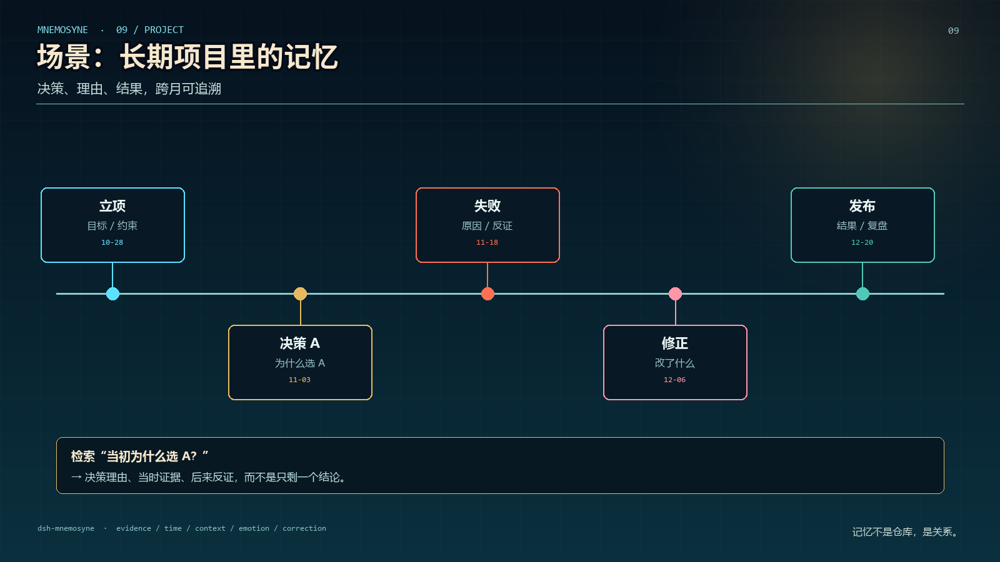

*决策、理由、失败和修正都留在时间线上，跨月仍可追溯。*

### 10.5 兴趣发展与自主探索

让 DSH Agent 能够根据现有记忆识别尚未解决的问题、需要验证的兴趣假设或值得进一步探索的主题。

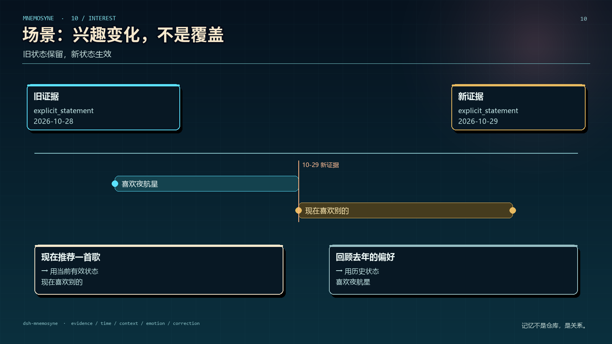

*旧状态保留，新状态生效；推荐现在用当前状态，回顾过去用历史状态。*

Mnemosyne 负责提供历史证据与状态；Agent 决定是否探索、探索什么，以及何时停止。

### 10.6 社区知识与协作

在适当权限和明确的数据边界下，记忆架构也可以为 DSH 中的项目协作、公共知识积累和事件复盘提供支持。

个人记忆、共享知识和公共事件必须明确区分访问权限、数据归属和使用范围，不能将私人记忆自动转化为社区知识。

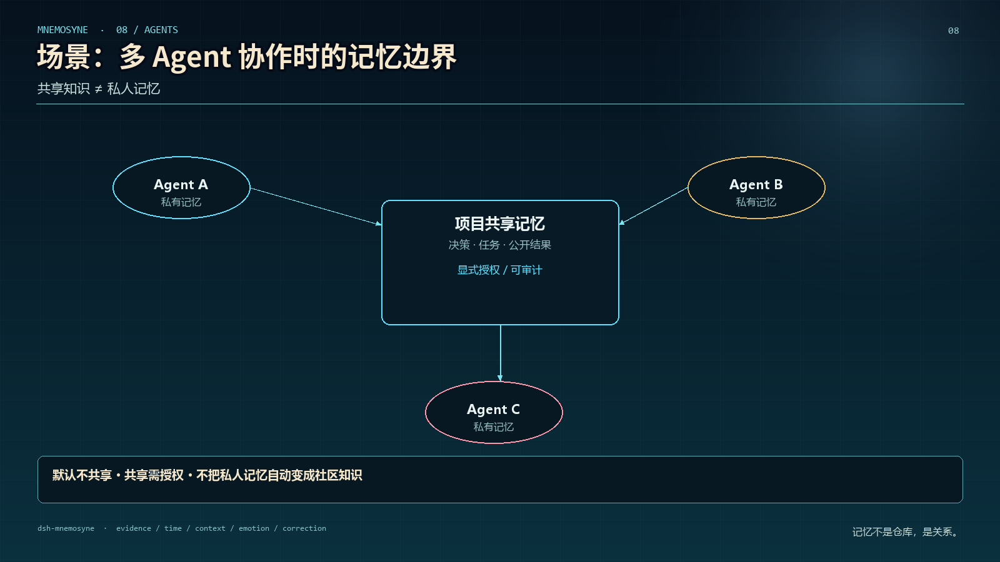

*默认不共享；共享需授权；私人记忆不会自动变成社区知识。*

### 10.7 记忆不等于意识

Mnemosyne 可以为连续的学习、关系理解和行为调整提供基础，但记忆系统本身并不意味着 Agent 拥有主观意识、真实情感或独立意志。

DSH 的长期发展需要记忆、推理、行动、反馈和治理机制共同工作。

---

## 11. 发展路线图

以下是建议的发展路线。具体阶段的完成状态应根据仓库实际代码、测试和发布记录维护，不应将规划自动视为已实现功能。

### Phase 0 — Architecture Audit

审计现有 Memory 架构，明确数据模型、入口、存储、检索、状态更新和纠错机制。

**目标：** 建立可信的技术基线，避免重复建设。

### Phase 1 — Evidence & Temporal Memory

完善证据来源、时间语义、有效期和状态演化。

**目标：** 让记忆能够表达信息何时成立，以及依据是什么。

### Phase 2 — Context & Relationship Modeling

扩展事件、主体、关系和空间情境的关联能力。

**目标：** 为情境化检索和长期关系理解建立基础。

### Phase 3 — Emotional Memory

增加复合情绪状态、情绪事件、个体化反应模式和情绪—行为关联评估。

**目标：** 让情绪成为有来源、有时间、有不确定性、可纠错的记忆维度。

### Phase 4 — Memory Evolution & Verification

强化去重、冲突处理、变更计划、幂等性、写入验证和错误恢复。

**目标：** 提高长期记忆的可靠性与可维护性。

### Phase 5 — Adaptive Retrieval

结合时间、情境、证据质量和状态有效性优化记忆检索。

**目标：** 在有限上下文预算下提供更适用的历史信息。

### Phase 6 — DSH Feedback Loop

将记忆与 Agent 的行动结果、经验复盘、兴趣探索和关系变化结合起来。

**目标：** 让 DSH 能够利用经验更新判断，同时保留决策边界、权限控制和可纠错性。

---

## 12. 评估标准

Mnemosyne 不应只以记忆容量或检索速度衡量质量。

建议建立以下评估维度：

| 评估维度  | 关键问题                   |
| ----- | ---------------------- |
| 事实准确性 | 系统是否正确保留原始信息？          |
| 时间准确性 | 是否区分过去状态与当前状态？         |
| 证据追溯  | 重要判断是否能够追溯到来源？         |
| 冲突处理  | 新旧信息冲突时是否能够识别并合理处理？    |
| 纠错能力  | 当事人纠正后，旧判断是否得到修正？      |
| 情绪准确性 | 是否允许复合情绪，并避免过度推断？      |
| 因果克制  | 是否避免把时间或情境相关性误当成因果？    |
| 个体化程度 | 是否能根据不同个体与情境调整反应模式？    |
| 检索适用性 | 取回的信息是否对当前任务真正有帮助？     |
| 长期连续性 | 是否能够正确连接共同经历与后续变化？     |
| 工程可靠性 | 是否支持幂等处理、失败恢复和写入验证？    |
| 成本与效率 | 记忆质量的改善是否值得相应的推理和存储成本？ |

建议采用相同模型、相近上下文预算和同一组测试案例，对比早期版本与演化版本。

重点关注的不只是准确率提升，还包括错误记忆率、错误情绪归因率、过期信息误用率和用户纠正后的修正成功率。

只有经过测试验证的能力，才应在发布说明中标记为已实现。

---

## 成本估算（参考）

> 以下为 API 费用量级估算，不是实际账单；按 `deepseek-flash` off-peak 价格计算，峰值时段约为表中金额 ×2。

### 计费口径

- **自动采集**：`session/event` 写入本地 SQLite，**不产生模型 API 费用**；
- **本地记忆服务**：FTS / 规则处理，**不调用外部 embedding / LLM**；
- **增量费用**来自：模型调用 `memory_search` / `memory_context` 的额外输入输出，以及插件 schema（约 773 tokens/请求，基本命中缓存）。

典型单轮：约 1.5 次模型调用，约 7,000 缓存输入 + 400 新输入 + 120 输出；召回频率按 30–50% 估算。

### 月度估算

| 使用强度 | 月对话轮数 | 插件增量费用 | 含插件总费用 |
| --- | ---: | ---: | ---: |
| 轻度（20 轮/天） | 600 | $0.03–0.09（¥0.2–0.6） | $0.08–0.15（¥0.6–1.1） |
| 日常（60 轮/天） | 1,800 | $0.09–0.27（¥0.6–1.9） | $0.25–0.45（¥1.8–3.2） |
| 重度（150 轮/天） | 4,500 | $0.23–0.68（¥1.6–4.8） | $0.70–1.10（¥5.0–7.8） |

峰值时段（`deepseek-flash` 价格翻倍）约为上表的 2 倍。

> 这是量级估算：实际取决于模型调用次数、召回频率、召回结果长度和缓存命中率。插件本身不产生独立的 API 订阅费。

---

## 13. 设计边界与隐私

Mnemosyne 面向长期陪伴，因此必须重视长期记忆可能造成的误解、过度推断和隐私风险。

### 证据边界

- 明确表达与模型推断应保持可区分。
- 不将未知信息自动补全为事实。
- 不仅凭一次行为就建立长期人格判断。
- 不仅凭时间、空间或情绪相关性推断因果关系。

### 情绪边界

- 情绪强度不是失去理性或行为失控的证明。
- 情绪—行为关联评分不是经临床验证的心理测量。
- 不根据少量对话推断心理疾病或隐藏动机。
- 对情绪相关的敏感推断采用保守的保存与使用策略。

### 数据边界

- 遵循现有 Memory 的权限、保留和删除机制。
- 不创建不必要的个人数据副本。
- 不将私人记忆自动共享给其他 Agent 或社区。
- 对敏感信息实行必要的访问控制与数据最小化。
- 保留必要的纠错依据，但避免无必要地永久保存敏感原始内容。

### 自主性边界

Mnemosyne 提供记忆与证据，不应以记忆推断为依据绕过权限或自动替用户采取行动。

记忆可以影响 Agent 的理解，但不应成为操纵用户、诱导依赖或利用个人弱点的工具。

---

## 14. 项目信息

**Mnemosyne — DSH Evolving Memory System**

中文定位：DSH 演化记忆系统

仓库 / 插件 ID：`dsh-mnemosyne`

所属项目：DSH（DeepSeek Harness）

核心方向：

- Temporal Memory
- Spatial & Contextual Memory
- Evidence Provenance
- State Evolution
- Emotional Memory
- Memory Correction
- Adaptive Retrieval
- Long-term Companion Continuity

Mnemosyne 希望探索的方向是：

**让 DSH 不只是记住过去，而是能够根据有依据的历史理解现在，并在新证据出现时修正自己对过去的理解。**

记忆的价值不在于永远保存一切，而在于在正确的时间，以正确的依据，保留和使用真正重要的信息。

---

*Mnemosyne 是一个持续演化的项目。本文描述其定位、设计原则与发展路线；具体功能的实现状态应以仓库中的代码、测试和发布记录为准。*
