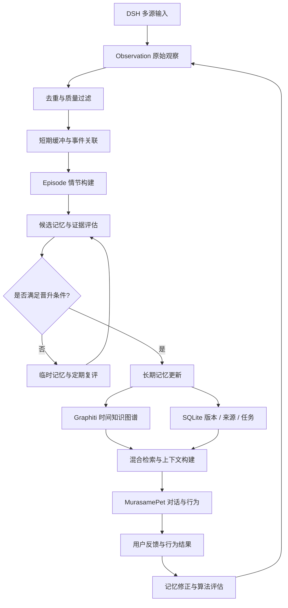

# DSH / MurasamePet：记忆链算法优化清单与可借鉴项目

> 用途：后续架构设计与开发排期。  
> 愿景与拟人化价值见 [`../services/mnemosyne/README.md`](../services/mnemosyne/README.md)。  
> 落地索引见 [`MNEMOSYNE_SPEC.md`](./docs/MNEMOSYNE_SPEC.md)。  
> 状态机与证据规则规格见 [`MNEMOSYNE_STATE_MACHINE.md`](./docs/MNEMOSYNE_STATE_MACHINE.md)。

## 核心链路

```
原始事件 → 短期缓冲 → 事件关联 → 情节记忆 → 行为模式 → 记忆筛选 → 长期记忆 → 用户模型
```

视频链路：

```
runStoryboard → 视频片段与时间戳 → 主题/实体提取 → 临时记忆 → 跨来源兴趣提取 → 长期记忆
```

**当前最值得优化的不是继续增加记忆层级，而是六个问题：**

1. 什么信息值得记住？
2. 多个事件怎样组成有意义的经历？
3. 什么证据足以形成长期兴趣判断？
4. 新旧记忆冲突时如何更新而不是覆盖？
5. 如何让记忆真正改善丛雨的对话与行为？
6. 怎样证明算法有效，而不是仅仅产生了更多记忆？

优先级：P0 = 基础正确性，P1 = 核心能力，P2 = 进阶能力，P3 = 后续研究。

---

## 一、完整优化清单

### A. 记忆形成算法

| 优化点 | 当前潜在问题 | 建议改进 | 优先级 |
| --- | --- | --- | --- |
| 观察与记忆分离 | 模型可能把推断当成事实 | Observation、Candidate Memory、Active Memory 分开存储 | P0 |
| 记忆准入规则 | 所有观察可能进入昂贵的认知链 | 价值、可靠性、新颖度、持续性、用户明确反馈共同判断 | P0 |
| 事件分段 | 固定时间窗口切断语义完整经历 | 话题切换、场景变化、用户行为、时间间隔联合分段 | P1 |
| 事件关联 | 相似内容易被错误合并 | 同时考虑时间、实体、因果线索和语义相似度 | P1 |
| 情节形成 | 只生成摘要而丢失过程 | 保存起因、过程、结果、参与实体、来源与时间范围 | P1 |
| 记忆去重 | 相同事实被多次写入 | 先实体归一化，再事实级去重与版本合并 | P1 |
| 记忆压缩 | 压缩后失去关键依据 | 保存压缩摘要，同时保留可寻址原始证据 | P1 |
| 记忆晋升 | 单次事件就被当成长期偏好 | 分阶段状态机 + 证据门槛，而非单一停留时长 | P0 |
| 记忆降级 | 过期信息长期占据上下文 | 区分失效、低优先级、暂时不确定、被新事实取代 | P1 |
| 记忆修正 | 新旧结论互相覆盖 | 保存版本、冲突关系与变更理由 | P0 |

### B. 基于心理学的认知机制

| 优化点 | 建议方案 | 要避免的错误 |
| --- | --- | --- |
| 工作记忆 | 维护当前会话、近期事件和待处理意图 | 不把它变成另一个无限增长的聊天记录 |
| 情节记忆 | 将经历组织为有边界的事件序列 | 不把所有相似主题都合并成一段经历 |
| 语义记忆 | 从多个情节提炼稳定事实、偏好和关系 | 不把模型推断伪装成确定事实 |
| 程序性记忆 | 记录已验证的互动习惯和有效策略 | 不让一次成功的行为直接变成固定规则 |
| 巩固机制 | 定期合并、压缩、关联和重新评估 | 不在每次对话后执行完整的昂贵推理 |
| 遗忘机制 | 按时效性、使用价值、可靠性、用户纠正动态调整 | 不用一套固定时间衰减公式处理所有记忆 |
| 提取线索 | 按当前话题、实体、场景和近期事件组合检索 | 不只依赖向量相似度 |
| 元记忆 | 记录来源、可信程度、最后验证时间及不确定性 | 不让模型随意生成没有计算依据的置信度 |
| 反事实与纠错 | 发现反例后重新评估既有判断 | 不让一次反例抵消大量可靠的长期证据 |
| 主动回忆 | 在相关时机调用记忆辅助对话 | 不把「主动学习」变成频繁打扰用户 |

原则：心理学提供设计启发，算法必须有操作定义。例如「巩固」应对应明确的合并 / 验证 / 更新 / 晋升操作，而不是提示词里写「睡眠时整理记忆」。

### C. 视频观察与兴趣提取

| 优化点 | 具体改进 |
| --- | --- |
| 观看事件识别 | 区分主动播放、后台播放、暂停、快进、跳出和重复观看 |
| 多模态分析 | 优先字幕与元数据，缺失时再 ASR / 视觉分析 |
| 视频分段 | 按场景变化、话题切换与语义完整性形成片段 |
| 观察粒度 | 同时保留视频级、片段级、主题级，避免整片压成一句话 |
| 兴趣特征 | 区分主动点击、停留、重看、评论、追问、明确喜欢 |
| 跨来源关联 | B 站、游戏、浏览器、对话中相关主题关联 |
| 临时记忆 | 有价值观察建立有期限临时记录（默认可配 7–30 天） |
| 兴趣晋升 | `UNKNOWN → WEAK_SIGNAL → CANDIDATE → CONFIRMED` 可配置状态机 |
| 兴趣衰退 | 结合近期行为、历史基线、反向证据，区分兴趣变化与偶然不活跃 |
| 来源回溯 | 每条兴趣判断可追溯到具体视频、片段、对话与时间点 |

**行为证据分层**（勿混成单一兴趣分数）：

| 层级 | 含义 | 例子 |
| --- | --- | --- |
| 被动暴露 | 未必有意关注 | 自动播放、后台播放 |
| 注意力信号 | 投入注意 | 停留、回看、主动暂停 |
| 主动参与 | 主动行动 | 搜索、评论、讨论、追问 |
| 明确反馈 | 直接态度 | 喜欢 / 不喜欢 / 想深入了解 |

权重应由实验调整，不宣称某组固定权重具有普遍心理学依据。

### D. 检索与上下文构建

| 优化点 | 建议 |
| --- | --- |
| 混合检索 | 语义 + 全文 + 实体 + 时间 + 图关系 |
| 多阶段排序 | 先召回，再按相关性、可靠性、时间与用途排序 |
| 时间查询 | 支持「现在 / 上个月 / 第一次发生时」等语义 |
| 上下文预算 | 按问题动态选用记忆，而非固定最近 N 条 |
| 证据随附 | 返回来源、时间、状态与必要反例 |
| 重复控制 | 高度相似记忆聚合，避免挤占上下文 |
| 置信度校准 | 仅在有明确评分规则与校准数据时称「可信度」 |
| 失败降级 | 图库 / 模型不可用时仍能本地索引近期记录 |

第一版优先复用 [Graphiti](https://github.com/getzep/graphiti) 的混合检索与时间事实能力，勿重复造图检索。

### E. 任务、可靠性与桌面部署

| 优化点 | 具体建议 |
| --- | --- |
| 独立进程 | DSH 管理启动、健康检查与退出 |
| 协议分离 | MCP ↔ Agent；REST ↔ DSH/UI；共用业务层 |
| 持久化任务 | 认知任务先落库再后台执行 |
| 失败恢复 | 超时、重试、退避、死信、手动重跑 |
| 幂等性 | 同一视频/任务重复提交不重复生成记忆 |
| 事务边界 | SQLite 观察+入队尽量原子；跨图库用可恢复补偿 |
| 数据版本 | 记忆版本、算法版本、提示词版本、模型标识 |
| 任务优先级 | 当前对话所需 ≫ 历史整理 / 批量回顾 |
| 资源限制 | 后台 LLM 并发、预算、超时、日限 |
| 数据管理 | 导出、备份、删除、来源追踪、迁移 |
| 本地安全 | REST 仅回环 + 本地认证 + 受控发现 |
| 可观测性 | 耗时、重试、提取错误、命中率、调用成本 |

第一版继续：`events / observations / memories / tasks / outbox / inbox` + SQLite FTS5。单用户桌宠不上 Kafka / 微服务集群。

### F. 评估、调试与自我改进

| 优化点 | 实施方式 |
| --- | --- |
| 可重放数据 | 去敏感观察与对话测试集，可反复跑算法 |
| 决策日志 | 记录为何忽略 / 保留 / 晋升 / 降级 |
| 算法版本化 | 改阈值、提示词、规则后可对比效果 |
| 反例测试 | 后台播放、误触、重复、讽刺、自相矛盾反馈 |
| 记忆质量 | 事实准确、来源完整、重复率、冲突处理 |
| 检索质量 | 召回、排序、历史时间正确性 |
| 用户体验 | 更自然接续、少重复问、少错误假设 |
| 资源评估 | CPU/RAM、库体积、延迟、单次记忆成本 |
| 安全与隐私 | 删除是否覆盖派生记忆；防提示注入操控认知链 |
| 策略实验 | 比较准入阈值、衰减、兴趣晋升规则 |

评测可参考 [Mem0 memory-benchmarks](https://github.com/mem0ai/memory-benchmarks)；注意托管专有优化 ≠ 开源 SDK 本地表现。

---

## 二、值得借鉴的项目

### 1. 核心记忆引擎

| 项目 | 角色 | 学什么 |
| --- | --- | --- |
| [Graphiti](https://github.com/getzep/graphiti) | **优先借鉴** | 时间事实、事件来源、实体关系、增量更新、混合检索 → 结构化知识层，不取代整条心理学链 |
| [Cognee](https://github.com/topoteretes/cognee) | 深度研究 | 多源摄入、`remember → recall → improve → forget`、反馈加权、删除流程 |
| [Mem0](https://github.com/mem0ai/mem0) | 轻量基线 | 事实提取、去重、实体关联、多信号检索与评测；用于对照「心理学链是否真更好」 |

### 2. 自主学习与持续运行

| 项目 | 学什么 | 注意 |
| --- | --- | --- |
| [Letta](https://github.com/letta-ai/letta) | 持续状态、空闲整理 / dreaming | 由本方状态机决定哪些修改可落地 |
| [LangGraph](https://github.com/langchain-ai/langgraph) | 检查点、长短记忆分离、可中断工作流 | 有现成调度器则只借鉴机制 |
| [Temporal](https://github.com/temporalio/temporal) | 长任务崩溃恢复与等待外反馈 | 先借鉴重试/恢复模式，桌宠单用户不必上全平台 |

### 3. 存储与检索基础设施

| 项目 | 借鉴 | 建议 |
| --- | --- | --- |
| [SQLite FTS5](https://www.sqlite.org/fts5.html) | 全文、关键词、BM25 | 第一版直接用 |
| FalkorDB | Graphiti 图后端 | 与 Graphiti 一起测资源 |
| Qdrant | 大规模向量 | 向量成瓶颈再独立部署 |
| LanceDB | 嵌入式向量 | 想少独立服务时的候选 |

先验证 Graphiti 检索效果，再判断缺口；勿同时引入多套向量库。

### 4. 测试分层

1. **基础记忆**：事实提取、来源保留、更新是否重复  
2. **长对话记忆**：跨轮、跨时间检索正确性  
3. **DSH 专属**：视频兴趣形成、纠正后修正、主动互动更自然  

比较项目基准前必须统一数据、模型、提示词、检索预算与评分标准。

---

## 三、建议架构：可回溯认知闭环

心理学记忆链保留，但从单向流水线升级为可纠错、可重放闭环。



**分工：**

- **图谱（Graphiti 等）**：事实关系、时间、检索  
- **心理学记忆链（本业务层）**：准入、证据累积、晋升、衰减、纠错、行为使用策略  

复用成熟组件，算法保持独立。

---

## 四、实施优先级与排期

### P0 · 第一阶段 — 数据模型与证据规则

- 统一 Observation / Episode / Candidate / Memory / Evidence 结构  
- 明确晋升、失效、纠正、删除规则  
- 每次决策保存原因与算法版本  

→ 规格落地：[`MNEMOSYNE_STATE_MACHINE.md`](./docs/MNEMOSYNE_STATE_MACHINE.md)

### P1 · 第二阶段 — 成熟引擎与可靠性底座

- Graphiti：时间图谱 + 混合检索  
- SQLite：原始观察、任务、版本、事件  
- 独立服务、REST/MCP、失败重试与恢复（骨架已有，继续加固）  

### P2 · 第三阶段 — 视频观察与兴趣演化

- 复用 `runStoryboard`  
- 观看行为与视频内容分开建模  
- 临时记忆、跨来源兴趣、反向证据、时间衰减  

### P3 · 第四阶段 — 自主整理与算法实验

- 低负载巩固  
- 比较准入与兴趣更新策略  
- 固定测试集验证准确性、纠错速度、主动互动收益  

---

## 五、借鉴 vs 自研 vs 实验

| 类别 | 内容 |
| --- | --- |
| **优先复用** | 图库、时间关系、混合检索、全文、基础向量、检查点、MCP/REST、任务重试、通用记忆评测 |
| **必须自研** | 心理学状态机、观察→情节规则、兴趣证据权重、临时晋升、遗忘/衰减、冲突处理、何时主动互动 |
| **必须实验** | 阈值、权重、衰减系数、回顾周期、主动接话时机、视频兴趣提取用哪类模型——**不是心理学常数** |

**最终建议：** 先不要装齐所有项目。Graphiti 做时间知识图谱，SQLite 做可靠性与原始证据，借鉴 Cognee 改善流程、Mem0 轻量基线、Letta 空闲整理思想，**心理学记忆链作为核心业务层**。

下一步可交付文档：[`MNEMOSYNE_STATE_MACHINE.md`](./docs/MNEMOSYNE_STATE_MACHINE.md)（状态、转移条件、证据类型、冲突、衰减、可重放日志、验收测试）。
